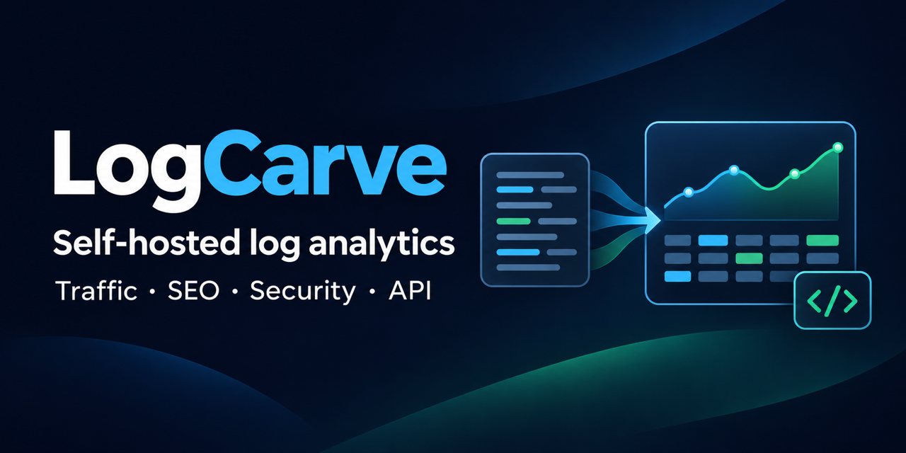

# LogCarve

Self-hosted web access-log analytics: reproducible traffic, crawler, SEO and security insight from your own Nginx and Apache logs.

[](LICENSE)
[](https://www.python.org/)
[](https://fastapi.tiangolo.com/)
[](https://docs.docker.com/compose/)
[](https://dev.meta.ai/docs/muse-code/interactive)
[](docs/verification.md)



## What it is

LogCarve imports NCSA Combined access logs (Nginx and Apache), including measured-timing presets, gzip archives and bounded administrator custom formats, normalizes them locally into SQLite, and serves one deterministic analytics layer to a browser dashboard, an authenticated read-only REST API and a small stdlib client. The dashboard, the API and the client share the same numbers and work with chat disabled, no model key and no Internet; the optional server-side AI assistant (Meta, OpenAI, Google Gemini, or Anthropic Claude — see [AI providers](docs/ai-providers.md)) uses that same layer when enabled.

LogCarve covers one site and one configured source at a time. Hostname and alias filtering selects within that site; it is not a multi-site platform.

Who benefits:

- **SEO and marketing** — crawler activity, bot versus browser-like traffic shares, referrers, broken inbound links and AI-crawler request paths.
- **Developers** — slow endpoints, measured latency where the format supplies it, error groups, status classes and a sortable request explorer.
- **Security reviewers** — deterministic investigation candidates (for example conflicting bot identity or 401/403 sequences) with rule and evidence references. User-Agent matches are claimed identities, never verified bots, and candidates are starting points, never confirmed attacks.

What LogCarve does not claim: visits, visitors, sessions, conversions, search rankings or training use cannot be derived from access logs alone. Missing timing stays `unavailable`, never zero. Country values are approximate country estimates from observed client addresses, not guaranteed registration countries and never who visited.

## Features

- Replay-safe batch imports, retention and online backups in local SQLite (WAL, migrations, one writer).
- Opt-in incremental follow with durable checkpoints, generation identity and rotation handling (`follow`, `replay-archive`); schema-gated `/readyz`. The browser starts no watcher.
- Overview graphs, timelines and weekday/hour heatmaps over an explicit display timezone.
- 77-rule bot catalog with traffic, category, provider and purpose filters, plus named-bot drilldowns.
- Sortable Requests explorer with per-row details, text/substring search plus exact original-address lookup, and country filtering.
- Performance (latency percentiles, slow endpoints), SEO (bot statuses, AI-crawler request paths), Referrers (sanitized URLs, broken inbound 404s), Journeys and Security pages.
- Saved filter views, current-versus-baseline comparison windows and full-result CSV/JSON export with reproducibility metadata.
- Authenticated read-only API (`/api/v1`) with scoped `analytics:read` tokens, plus a stdlib-only Python client.
- Local no-model evidence rechecks ([evidence revalidation](docs/evidence-revalidation-2026-11-03.md)): replay the exact signed scope against current data and report current, changed, unavailable or unverified. Links rerun the same scope against current data; they are not archived snapshots and do not validate arbitrary AI prose.
- Local-first browser UI: bundled assets with no CDN or tracking, light and dark themes, English UI, server pagination.
- Privacy by default: query values discarded, Referer minimized, secrets masked, client addresses pseudonymized with a secret HMAC key.

## Quickstart: synthetic demo

This quickstart runs a persistent 120-row synthetic demo on loopback. It imports no real logs and needs no model key.

Prerequisites:

- Git and curl on the host.
- Docker with the Compose plugin 2.24.0 or newer (optional `env_file` `required: false` needs 2.24.0+).
- Host Python 3 for demo initialization/helpers and the API client examples.

```bash
git clone --branch feature/logwerk-parity-ready-2026-11-02 https://github.com/abbottis/logcarve.git
cd logcarve
./scripts/demo/init.sh
./scripts/demo/start.sh
./scripts/demo/health.sh
```

What the scripts do:

- `init.sh` is first-time setup only: it creates the protected `artifacts/local-demo-secrets/demo.env` file and refuses to overwrite it.
- `start.sh` builds the image, starts the service and seeds the combined 120-row synthetic dataset (idempotent).
- `health.sh` checks public liveness and gated readiness without printing secrets.
- `stop.sh` stops the demo and keeps its data.

Then open the fixed window covering all 120 synthetic rows:

[Open the demo overview (all 120 rows)](http://127.0.0.1:8080/?site=default&range=custom&from=2026-10-26T00:00:00%2B00:00&to=2026-11-01T00:00:00%2B00:00&tz=Europe%2FBerlin&source=example-combined)

[Open the Requests explorer (same window)](http://127.0.0.1:8080/requests?site=default&range=custom&from=2026-10-26T00:00:00%2B00:00&to=2026-11-01T00:00:00%2B00:00&tz=Europe%2FBerlin&source=example-combined)

Log in as `demo-admin`. The generated password is in `artifacts/local-demo-secrets/demo.env` (`LOGCARVE_ADMIN_PASSWORD`). Never publish that file. A fresh demo starts with AI off by default (empty model key), mounts sources read-only, runs as a non-root user and publishes only on `127.0.0.1:8080`. An owner-enabled assistant profile is supported after configuring provider/model selection, key, data policy and a separate runtime usage grant (see [AI providers](docs/ai-providers.md)).

The seeded dataset holds 120 synthetic rows on source `example-combined`: 30 legacy rows (26–28 Oct 2026) plus 90 enriched rows (29–31 Oct 2026). The fixed window above covers both, so it stays complete after the default seven-day window has moved past the fixture dates. `reset.sh` replays the same verified fixtures without touching auth or usage state.

## Using the dashboard

- Overview shows aggregate charts; Requests is the individual log-line explorer with one sortable row per request.
- Filters apply with **Apply**; column headers sort; **Details** expands a row; full downloads appear below the table.
- Country results need a separately mounted genuine database; without it, GeoIP honestly reports `unavailable`. Rows without a known country stay `Unknown`.
- Without the optional encrypted original-IP setup, original addresses stay uncaptured and the related display shows `unavailable`.
- Pages share one filter engine: Overview, Requests, Crawlers, Performance, SEO, Referrers, Journeys, Security, Errors, Comparison, saved views and Help.

A scoped `analytics:read` token (issued at seed time, shown once) reads the same analytics over HTTP:

```bash
export LOGCARVE_API_TOKEN="lc_..."
curl -s -H "Authorization: Bearer $LOGCARVE_API_TOKEN" \
  "http://127.0.0.1:8080/api/v1/summary?site_id=default&from=2026-10-26T00:00:00%2B00:00&to=2026-11-01T00:00:00%2B00:00"
```

The [stdlib client](clients/logcarve_api_client.py) performs the same calls without dependencies; see the [external API](docs/external-api.md) for all endpoints. Full-result exports cover the entire filtered selection (no silent truncation); selections above 250000 rows are refused with `export_too_large` so you narrow the window instead.

## Your own logs

Production use is operator-configured. Configure approved source roots and source IDs, read-only mounts, and secrets through the environment (see [.env.example](.env.example)) before starting, then use CLI ingestion. The base Compose file requires operator secrets; do not copy demo credentials elsewhere. No real-log sample is shipped in this repository.

Start here:

- [Deployment](docs/deployment.md) — hosts, mounts, secrets, offline behavior.
- [Log formats](docs/log-formats.md) — Combined, timing presets, gzip, custom mappings.
- [Privacy and data egress](docs/privacy-and-security.md) — pseudonymization, masking, model boundaries.
- [AI providers](docs/ai-providers.md) — the four supported providers, backend Settings onboarding, allowance, and troubleshooting.
- [Security](docs/security.md) — auth, tokens, CSRF, review guidance.
- [External API](docs/external-api.md) — endpoints, tokens, export contract.
- [Backup and restore](docs/backup-restore.md) — online backups, retention.

## Configuration at a glance

Host and storage settings come from the environment; see [.env.example](.env.example) for the full contract with no real secrets inside. Provider selection, keys, and data policy live in the backend Settings page (see [AI providers](docs/ai-providers.md)):

- `LOGCARVE_LOG_PATHS`, `DATABASE_PATH`, `DEFAULT_TIMEZONE`, `RETENTION_DAYS` — where logs are read and state is kept.
- `SESSION_SECRET`, `HMAC_KEY` — distinct server secrets for sessions and address pseudonymization.
- `ORIGINAL_IP_KEY` — separate key for the optional encrypted original-IP store; empty keeps originals uncaptured.
- `GEOIP_DB_PATH` — optional path of the operator-mounted genuine country database; empty keeps lookups honestly `unavailable`.
- `AI_SETTINGS_KEY` — dedicated key encrypting the per-provider model keys stored via backend Settings; never shared with other secrets.
- `AI_ENABLED=false` with an empty `MODEL_API_KEY` — AI off by default; enabling chat additionally requires selecting a provider/model, a verified data mode, budget settings, an explicit runtime usage grant (no grant exists initially) and saving backend Settings (see [AI providers](docs/ai-providers.md)).

## Repository map

- `app/` — ingestion, deterministic analytics, API transport, model adapter and web rendering.
- `config/` — bot and security rule catalogs plus configuration examples.
- `clients/` — the stdlib-only external API client.
- `scripts/demo/` — the synthetic demo lifecycle (`init`, `start`, `health`, `stop`, `reset`).
- `docs/` — MVP, architecture, formats, API, deployment, verification and provenance records.

## Optional assistant

An internal assistant is available server-side from Meta, OpenAI, Google Gemini or Anthropic Claude when explicitly enabled with your own account, API access, data mode and usage limits. Providers and models are configured in the backend Settings page with per-provider encrypted keys, explicit data-policy acknowledgment and a separate explicit runtime usage grant. It uses bounded read-only analytics tools and reports evidence IDs, filters, coverage and limitations with every finding. The dashboard and the API work fully without it, and a fresh demo starts with AI off by default. Model failure never takes deterministic analytics offline. Setup, per-provider policy, and troubleshooting are covered in the [AI providers guide](docs/ai-providers.md).

| Provider | Model | Processing tier | Verification |
|---|---|---|---|
| Meta | `muse-spark-1.3` | Standard | Owner-authorized synthetic run PASS |
| OpenAI | `gpt-6.1-terra` | Standard (`service_tier: "default"`) | Owner-authorized synthetic tool-to-evidence retest PASS on 2026-11-02 — see [verification history](docs/verification.md) |
| Google Gemini | `gemini-3.8-flash` | Paid API (Standard by omission) | Owner-authorized synthetic tool-to-evidence tests PASS on 2026-11-02 — see [verification history](docs/verification.md) |
| Anthropic Claude | `claude-sonnet-5-5` | API (`service_tier: "standard_only"`) | Owner-authorized synthetic tool-to-evidence tests PASS on 2026-11-02 — see [verification history](docs/verification.md) |

See the [AI providers guide](docs/ai-providers.md) for endpoints, pricing provenance and onboarding.

## Documentation

- [Demo operation](docs/demo.md) and [deployment](docs/deployment.md)
- [Log formats](docs/log-formats.md), [external API](docs/external-api.md), [backup and restore](docs/backup-restore.md)
- [Acceptance criteria](docs/acceptance-criteria.md), [verification history](docs/verification.md), [acceptance checklist](docs/acceptance-checklist.md)
- [Architecture](docs/architecture.md), [MVP scope](docs/mvp.md), [security](docs/security.md), [privacy and data egress](docs/privacy-and-security.md)
- [Contribution provenance](docs/hackathon-contributions.md), [third-party notices](THIRD_PARTY_NOTICES.md)
- [Contributing](CONTRIBUTING.md), [security reporting](SECURITY.md)

## Status

Preview ready for local evaluation. Linux ARM64 container, offline and browser proofs are recorded in the [verification history](docs/verification.md); native Linux x86-64 is not yet verified and owner manual acceptance is pending. See the [acceptance criteria](docs/acceptance-criteria.md) for precise scope.

## Hackathon

LogCarve is a project developed for the [Meta Global AI Developer Hackathon (2026)](https://dev.meta.ai/events/global-hackathon), Indie developer track. Built with Muse Code and Muse Spark 1.3.

Thank you to Meta AI for the models, the developer tools and the hackathon opportunity.

## License and provenance

Original LogCarve code and documentation are [Apache-2.0](LICENSE). Seventy bot-catalog patterns and labels were adapted from the public LogWerk rule catalog and retain their upstream MIT notice; see [third-party notices](THIRD_PARTY_NOTICES.md). No LogWerk application code or assets were copied. The GeoIP database is operator-mounted data (DB-IP Country Lite, CC BY 4.0) and is never bundled or committed.
