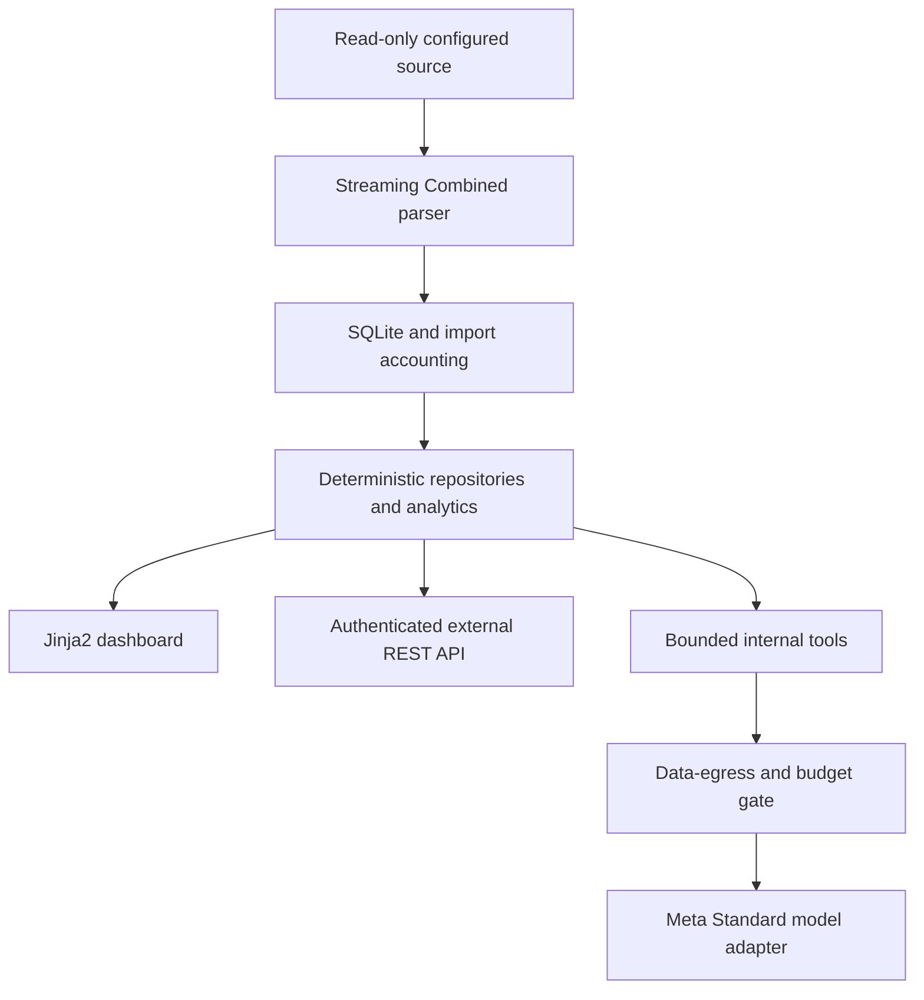

# Proposed architecture

Status: proposed, derived from spec v0.4; see [ADR 0001](decisions/0001-mvp-architecture.md).

The assistant consumes analytics. Its import, configuration or startup failure must not prevent the external API or dashboard from serving deterministic data. API/AI share query services, not HTTP calls back into themselves or a duplicated metrics engine.

## Module ownership

| Directory | Owns | Must not own |
| --- | --- | --- |
| `app/ingestion/` | Source validation, streaming parse/normalization, import identity/accounting | Source mutation, analytics UI or provider calls |
| `app/db/` | Connection lifecycle, parameterized repositories, migrations and persistence | Model/network access or HTTP authorization |
| `app/analytics/` | Typed filters, deterministic aggregations, classifications, evidence metadata | HTTP transport or LLM-generated queries |
| `app/auth/` | Local sessions, hashed tokens, scope/site authorization | Model access or parsing business logic |
| `app/api/` | Pydantic contracts, versioned routes, authorization checks and safe errors | Independent metric calculations |
| `app/ai/` | Adapter, prompts, tool registry, egress/usage/budget limits and evidence answers | Raw file/DB access or arbitrary executable tools |
| `app/web/` | Templates, fragment routes, theme behavior and locally served builds | A second analytics engine |
| `assets/src/` | Authored CSS/JS for a build step | Runtime CDN dependencies |
| `config/` | Nonsecret examples, versioned rules and English catalog | Actual deployment credentials |

`app/main.py` will be the composition root after plan approval. Shared configuration/DTO modules should be introduced only as the first use requires them, with no unnecessary abstraction layer.

## Storage and identifiers

Start with spec §2.5 domain tables: `sites`, `log_sources`, `imports`, `requests`, `schema_migrations`; decide whether `findings` is derived or persisted. Auth/session/token storage is a concrete security need to design explicitly, not an excuse for generic ORM scaffolding.

Use SQLite WAL, one writer, transactions, measured indexes and local persistent storage. Preserve UTC timestamps and original offset context. Store HMAC-pseudonymized client IDs, sanitized paths/Referer and nullable duration. Record the rule/version necessary to explain classifications.

For idempotency, distinguish replaying the same imported record from legitimate identical requests at the same timestamp. File/import identity and record position need an explicit tested design; a hash of normalized event contents alone is insufficient.

## Contracts and trust boundaries

External reads are authorized independently of browser sessions. Both API and model tools enforce site, time range, result bounds and allowlisted operations. Administrative import/retention and chat are separately authorized. The product has no model-proxy route.

Outputs include filter/coverage/quality metadata; findings and chat add traceable evidence. Missing duration and partial source coverage stay visible through storage, query, JSON and UI layers.

All browser assets are local. Production runs behind TLS with a non-root container, log-directory read-only mount and a writable persistent data volume. Development MCP tools are never product containers/dependencies. See [deployment](deployment.md).

## Pending choices

The recommended FastAPI/Pydantic, Jinja2/htmx, Tailwind 4/daisyUI 5/Chart.js 4 and SQLite design is recorded for review, not silently marked accepted. Package versions/lockfiles, auth layout, retention behavior, credential onboarding, deployment host and project license remain decisions. No runtime manifest or dummy application is generated by this scaffold.
