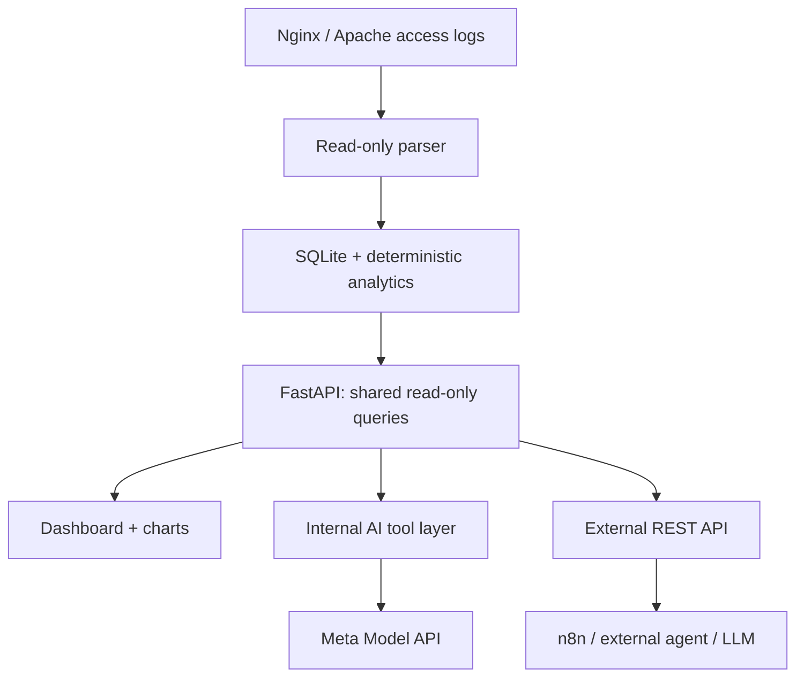

# Technical Product Specification

**Title of Project:** LogCarve — AI-Assisted Server Log Analytics

> **Working title:** AI-Assisted Server Log Analytics for Security, SEO, and Development

> **Version:** 0.4 — Meta Hackathon Credit Terms, model-data policy and privacy/security gates

> **Date:** 2026-10-28

> **Owner:** Tobias Glawe

> **Context:** Meta Global AI Developer Hackathon 2026 · Indie Developer Track

> **Product language:** English; this specification is written in German for project planning.

> **GitHub-Repo:** <https://github.com/abbottis/logcarve>

## 0. Dokumentstatus und Priorisierung

Dieses Dokument ist eine **technische Soll-Spezifikation, keine Beschreibung bereits implementierter Funktionen**. Es führt die besprochenen Anforderungen zusammen und ergänzt explizit als Empfehlungen markierte technische Entscheidungen.

| Kennzeichnung | Bedeutung |
| --- | --- |
| **MUST / MVP** | Für eine funktionsfähige Hackathon-Einreichung vorgesehen |
| **SHOULD / MVP** | Wünschenswert, wenn ohne Gefährdung des Kernpfads umsetzbar |
| **P1** | Erste Erweiterung nach funktionierendem MVP |
| **P2** | Späterer Ausbau, nicht Teil des Hackathon-Versprechens |
| **DECISION** | Architekturvorschlag, vor Implementierung kurz zu bestätigen |

**Verbindlicher MVP-Rahmen:** eine Website, ein zunächst unterstütztes Logformat (NCSA Combined als gemeinsamer Einstieg für Nginx und Apache), lokale persistente Datenhaltung, browserbasiertes Dashboard sowie **zwei unabhängig funktionsfähige Integrationswege**: (1) ein interner KI-Assistent auf Basis von Meta-Modellen und (2) eine authentifizierte Read-only-REST-API, über die externe KI-Agenten und Workflows strukturierte Daten abrufen können, auch wenn der interne KI-Assistent deaktiviert ist. Historische Logs werden zunächst im Batch importiert. Kontinuierliche Aufnahme ist optional. Die Arbeit wird mit **Muse Code**, bevorzugt **Muse Spark 1.3 Standard** und gezielt **Muse Wonder 1.0 Standard**, organisiert. Für die Meta-Nutzung stehen nach Nutzerangabe **150 USD Hackathon-Credits** zur Verfügung, **sobald sie dem korrekten Meta-Teamkonto gutgeschrieben wurden**. Nach den vom Nutzer bereitgestellten Credit Terms verfallen gutgeschriebene Credits nicht regulär, werden aber bei Kontobeendigung bzw. Widerruf verwirkt; **Ausgaben oberhalb der Credits sind kostenpflichtig**.

### 0.1 Ziel und Nicht-Ziele

**Ziel:** Ein kleines, auf Linux selbst betreibbares Analysewerkzeug liest lokale Webserver-Access-Logs, normalisiert Ereignisse deterministisch, berechnet nachvollziehbare Kennzahlen und ermöglicht Untersuchungen im Dashboard sowie in einem KI-Chat mit zitierbarer Datengrundlage.

**Nicht-Ziele des MVP:** vollwertiges SIEM, IDS/WAF, automatisches Blockieren von IPs, echte Attribution von Anzeigen-Conversions, Ersatz für Google Search Console oder GA4, verteilte Logverarbeitung, Multi-Tenant-SaaS, Rohlog-Suche in Milliarden Datensätzen, allgemeiner SQL- oder Shell-Agent.

## 1. Infrastruktur

### 1.1 Laufzeit und Installation

- **MUST:** Linux x86-64 als Referenzumgebung; ARM64 nach Image-Test möglich.
- **MUST:** Self-hosted, zuerst **Docker Compose** als reproduzierbarer Installationsweg; keine Pflicht zu Cloudflare, Kubernetes, SaaS oder Managed-Datenbank.
- **MUST:** Container für Anwendung/API/Dashboard mit **Python 3.12+**, FastAPI und ASGI-Server. SQLite-Daten auf persistentem Volume bzw. Host-Verzeichnis.
- **MUST:** Installation mit einer dokumentierten `.env` und `config.yaml`, `docker compose up -d --build`; Demo auch lokal mit Testlogs startbar.
- **MUST:** Im Container nicht als root laufen; keine privilegierten Container, kein Docker-Socket-Mount.
- **MUST:** Für das Browser-Frontend ein Reverse Proxy mit TLS; die Anwendung selbst hört vorzugsweise nur auf `127.0.0.1` oder in einem privaten Docker-Netz.
- **MUST:** Die hackathonspezifische Auswahl erlaubter Modelle und die Modellkennung für Muse Spark Open aus **§ 2.10** beachten. Die Modellwahl ist keine Anforderung an den Linux-Installationspfad.
- **SHOULD:** Auf Plesk/HostEurope hinter bestehendem Nginx-Reverse-Proxy betreibbar. Kein Eingriff in produktive Plesk-Webserver-Konfiguration als Installationsvoraussetzung.
- **P1:** Installation ohne Container via Python-Virtualenv + `systemd`.
- **P2:** Konfigurierbarer Betrieb mehrerer Sites/Hosts auf einem Server.

**Beispiel einer Zielstruktur auf dem Host (Pfade werden bei Installation festgelegt):**

```text
/opt/logcarve/ # Anwendung / Compose-Konfiguration

/var/lib/logcarve/ # SQLite, Import-Status, Caches

/etc/logcarve/ # geschützte Konfiguration/Secrets

/var/log/nginx/ # nur lesbare Beispiel-Logquelle

/var/log/apache2/ # alternativ: Apache-Logquelle
```

Plesk, Distributionen und virtuelle Hosts verwenden abweichende Logpfade. Daher **keine fest codierten Pfade** im Programm.

### 1.2 Zugriff auf Logfiles direkt vom Server

- **MUST:** Der Parser liest Logdateien über explizit konfigurierte, lokale Hostpfade bzw. als **read-only Bind-Mounts** in den Container eingebundene Verzeichnisse.
- **MUST:** Kein Schreiben, Löschen, Trunkieren oder Ändern der ursprünglichen Webserver-Logs.
- **MUST:** Lesezugriff über dedizierte, möglichst gering privilegierte Benutzer-/Gruppenrechte oder eng begrenzte ACLs. **Kein `chmod 777`** und kein globaler root-Zugriff.
- **MUST:** Nur administrativ konfigurierte und validierte `source_id`/Pfade; keine frei vom Web-Client übergebenen Dateipfade, keine Path-Traversal- oder Symlink-Flucht aus freigegebenen Wurzeln.
- **MUST:** Import vorhandener Logs auf Befehl (CLI und geschützte Admin-Oberfläche); Dateityp und Format im Importbericht anzeigen.
- **SHOULD:** `.log` und rotierte Dateien, später `.gz`; für Batch-Import Dateigröße, Zeilen, Fehler und Dauer protokollieren.
- **P1:** Inkrementelles Nachlesen auf Grundlage von Dateikennung, Offset und Import-Checkpoint; Logrotate/Rename/Copy-Truncate nachvollziehbar behandeln.
- **P2:** Dauerhafte Ingestion über Watcher/Polling, periodische Jobs sowie mehrere Logquellen.

**Wichtig:** Für Logrotation bei Docker besser das **Elternverzeichnis read-only mounten** als nur die einzelne Logdatei, damit neue Dateien/Inodes nach Rotation sichtbar werden. Ein read-only Mount verhindert Schreibzugriffe, ersetzt aber keine korrekt gesetzten Linux-Leserechte.

### 1.3 Netzwerk und externe Abhängigkeiten

- **MUST:** HTML, CSS, JS, Fonts, Icons, Chart-Library und Komponenten-Styles werden **vom eigenen Server** ausgeliefert. Keine CDN-URLs, Google Fonts, externen Icon-Fonts, Drittanbieter-Analytics oder Tracking-Pixel.
- **Ausnahme / MUST:** Serverseitige, ausgehende Verbindung zur **Meta Model API** für die KI-Funktion des Hackathons; keine Browser-direkten Aufrufe mit API-Key.
- **MUST:** Ohne Internetverbindung funktionieren Parsing, Datenbank, Dashboard, Filter und deterministische JSON-API weiterhin; der KI-Chat zeigt dann eine verständliche Fehlermeldung bzw. einen deaktivierten Zustand.
- **SHOULD:** Telemetrie standardmäßig aus; keine automatischen Cloud-Uploads von Logs.
- **MUST:** Bei Verwendung der Meta Model API nur definierte Server-zu-Provider-Verbindungen; keine Freigabe oder Weiterleitung des Meta-API-Keys an externe Agenten und **kein allgemeiner Meta-Modellproxy oder -Aggregator**. Die externe LogCarve-API exportiert eigene Analysedaten, nicht Meta-Modellzugriff.
- **MUST:** Bei für Dritte erreichbarer KI-Funktion die Meta Model API Geographic Use Policy und deren Beschränkungen für Nutzerstandorte berücksichtigen; geeignete Zugriffssteuerung bzw. deaktivierbare KI-Funktion vorsehen. Regionale Zulässigkeit nicht aus dem Serverstandort allein ableiten.

### 1.4 Sprache und spätere Lokalisierung

- **MUST:** Produkt, UI-Texte, API-Feldnamen, Meldungen, Starterfragen und Dokumentation initial in **English (`en`)**.
- **MUST:** UI-Strings nicht verstreut hardcoden. Schlüsselbasierter i18n-Katalog (z. B. `locales/en.json`) ab Tag 1; Fallback `en`.
- **MUST:** Zeitstempel intern UTC/ISO 8601 mit Zeitzonenbezug; im UI gewählte Zeitzone formatieren, keine fest eingebaute Server-Ortszeit.
- **P1:** `de` ergänzen; Locale-Auswahl, übersetzbare Kategorien, Formatierung von Zahlen/Datum, `lang`-Attribut und übersetzte ARIA-Labels.
- **P2:** Weitere Lokalisierungen, aber kein Laufzeit-Übersetzungsdienst als Abhängigkeit.

## 2. Technische Specs

### 2.1 Empfohlener Software-Stack

| Schicht | Festlegung / Empfehlung | Grund |
| --- | --- | --- |
| Backend | **Python 3.12+ / FastAPI / Pydantic** | Typisierte API, einfache Validierung, OpenAPI, kleiner Dienst |
| Templates | **Jinja2 / HTML5** | Serverseitiges Rendering, wenig Browser-JS |
| Progressive Interaktion | **htmx**, lokal gebündelt | Filter, Tabellen und Fragmente ohne SPA-Framework |
| Styling | **Tailwind CSS 4**, Build zur Entwicklungs-/Image-Bauzeit | Keine Tailwind-CDN-Laufzeit |
| Freie UI-Komponenten | **daisyUI 5** (MIT, als Tailwind-Plugin) | CSS-basierte Komponenten, Dialoge, Tabs, Formulare, Themes |
| Charts | **Chart.js 4**, per npm installiert und lokal gebündelt (MIT) | Linien-, Balken- und Donut-Diagramme ohne großes Frontend-Framework |
| Datenbank | **SQLite**, WAL-Modus, Schema-Migrationen | Eine Instanz, wenig Administration |
| Datenzugriff | Repository-/Query-Schicht mit parametrisierten SQL-Abfragen | Kontrollierte, reproduzierbare Metriken |
| Fonts | **Inter Variable** für UI; **JetBrains Mono Variable** für technische Werte | Gute Lesbarkeit; OFL-lizenzierte, selbst gehostete Webfonts |
| Tests | pytest, FastAPI-Testclient/httpx, Playwright für Kernpfade | Parser-/API-/UI-Regressionen |
| Packaging | Dockerfile + `compose.yaml`, lockfile | Reproduzierbare Bereitstellung |
| KI zur Laufzeit | Meta **Muse Spark 1.3 Standard** (`muse-spark-1.3`) via Meta Model API, serverseitiges Tool-Calling | Hackathon-konformer echter Meta-Modelleinsatz; konfigurierbare Modell-ID |

**DECISION:** Kein React/Next.js, keine separate Node-Produktivlaufzeit und kein Redis/Postgres im MVP. Node ist nur für den Asset-Build erforderlich. Parquet/Polars bleiben P1/P2, falls Benchmarks SQLite als Engpass zeigen.

### 2.2 High-Level-Architektur



Prinzip: **Logparser, Klassifizierung, Aggregation und Alert-Regeln sind deterministisch.** Das interne Modell recherchiert über erlaubte Read-only-Funktionen und formuliert evidenzgestützte Erklärungen – es erhält weder freien Datenbank- noch Shellzugriff. Die **externe REST-API** nutzt dieselbe Analytics-Schicht, benötigt aber selbst keinen aktiven internen LLM-Dienst.

### 2.3 Unterstützte Webserver- und Logformate

| Quelle / Format | MVP | Erweiterung | Bemerkung |
| --- | --- | --- | --- |
| **Nginx Combined** | MUST | — | Default `combined`; Referrer + User-Agent vorhanden |
| **Apache 2.4 Combined** | MUST | — | Gleiche NCSA-Grundstruktur; mit gemeinsamen Parser-Fixtures testen |
| **Nginx / Apache Common (CLF)** | SHOULD | P1 | Ohne Referrer/User-Agent; Bot- und Marketing-Analysen dann eingeschränkt |
| **Nginx mit `$request_time`** | SHOULD | P1 | Latenz nur bei explizitem Feld; Format-Mapping nötig |
| **Apache mit `%D` oder `%{ms}T`** | SHOULD | P1 | Unterschiedliche Zeiteinheiten normalisieren |
| **Nginx JSON Lines** | — | P1 | Eigene strukturierte `log_format … escape=json`-Variante |
| **LiteSpeed/OpenLiteSpeed** | — | P1 | Zuerst tatsächlich ausgegebenes Combined-/Custom-Format per Fixtures verifizieren |
| Plesk-spezifische Custom-Logs | — | P1/P2 | Presets + konfigurierbare Feldzuordnung |
| Error-Logs (Nginx/Apache) | — | P2 | Andere Semantik und Parser; getrennt von Access-Log-MVP |
| CDN-/Proxy-/WAF-Logs | — | P2 | Keine stillschweigende Gleichsetzung mit Origin-Logs |

**NCSA Combined-Beispiellinie** (synthetisch):

```text
203.0.113.20 - - [27/Oct/2026:10:15:32 +0100] "GET /missing-page HTTP/1.1" 404 153 "https://example.org/old-link" "ExampleCrawler/1.0"
```

**Zu erfassende Kernfelder:** `timestamp`, Zeitzonenoffset, Client-IP/-Pseudonym, HTTP-Methode, Request-Target, normalisierter Pfad, HTTP-Version, Status, Response-Bytes, Referer, User-Agent, Quelle/Host, optional Response-Time und Upstream-Time.

**Nginx:** Die vordefinierte `combined`-Struktur basiert auf `$remote_addr`, `$remote_user`, `$time_local`, `$request`, `$status`, `$body_bytes_sent`, `$http_referer`, `$http_user_agent`.

**Apache:** `LogFormat "%h %l %u %t \"%r\" %>s %b \"%{Referer}i\" \"%{User-agent}i\"" combined` ist inhaltlich kompatibel. Apache-Zeitwerte `%D` sind Mikrosekunden; `%{ms}T` ergibt Millisekunden. Nginx `$request_time` liefert Sekunden mit Millisekundenauflösung. Sämtliche Zeitwerte werden intern auf `duration_ms` normalisiert.

**MUST:** Fehlende Timing-Felder ergeben `null` und UI-Hinweis **“Response-time data unavailable for this log source”** – keine erfundenen Latenzwerte.

### 2.4 Parsing und Normalisierung

- **MUST:** Streamender, zeilenweiser Parser mit begrenztem Speicherbedarf. Keine komplette Logdatei in den RAM laden.
- **MUST:** Robuste Behandlung von quoted fields, Leerzeichen, escaped quotes, IPv4/IPv6, `-` als fehlendem Wert, `HTTP/2.0`/ungewöhnlichen Request-Lines und ungültigen Bytes.
- **MUST:** Strenges Format-Preset je Quelle. Nicht erkannte Zeilen werden gezählt und mit gekürztem, maskiertem Diagnosekontext protokolliert, ohne den gesamten Import zu stoppen.
- **MUST:** UTC-Normalisierung mit Beibehaltung des ursprünglichen Offsets im Quellkontext.
- **MUST:** Request-Target in `path` und optional `query` zerlegen; standardmäßig keine Query-Werte persistieren, um Tokens/PII-Leaks zu vermeiden. Originale Rohzeile nicht langfristig speichern.
- **MUST:** Maximalgrößen für Zeile, URL und User-Agent definieren; fehlerhafte oder extrem lange Einträge kontrolliert verwerfen bzw. truncieren.
- **MUST:** Idempotenter Re-Import derselben Datei mit File-Fingerprint/Import-ID und Datensatzschlüssel; keine doppelten Ereignisse bei wiederholtem Batch-Import.
- **SHOULD:** Batch-Inserts/Transaktionen, Indizes nach `timestamp`, `status`, `path`, `bot_family`, `source_id`.
- **P1:** Komprimierte Rotationsarchive `.gz`, Format-Erkennung mit Bestätigungsdialog, konfigurierbare Custom-Format-Maps.

### 2.5 Datenmodell (MVP)

| Tabelle | Zweck und Pflichtfelder |
| --- | --- |
| `sites` | `id`, `name`, `hostname`, `timezone`, `created_at` |
| `log_sources` | `id`, `site_id`, `server_type`, `format_id`, `path_alias`, `enabled` |
| `imports` | `id`, `source_id`, `file_fingerprint`, `started_at`, `finished_at`, `lines_total`, `lines_ok`, `lines_rejected`, `status`, `error_summary` |
| `requests` | `id`, `import_id`, `site_id`, `ts_utc`, `method`, `path`, `status`, `bytes`, `referer_host`, `user_agent`, `client_ip_hash`, `bot_family`, `bot_confidence`, `duration_ms` nullable |
| `findings` | `id`, `site_id`, `rule_id`, `severity`, `first_seen`, `last_seen`, `count`, `evidence_filters`, `state` |
| `schema_migrations` | Datenbankschema-Version, migrationsfähige Upgrades |

**DECISION:** Für den MVP kann `findings` bei jeder Abfrage deterministisch berechnet werden; persistente Finding-Lebenszyklen und kommentierbare Fälle erst P1. Keine zusätzlichen Tabellen ohne konkreten Use Case.

**Datenhaltung:** SQLite WAL auf lokalem, persistentem Dateisystem; eine Schreibinstanz; Transaktionen, Integritätsprüfung, Backup/Restore-Dokumentation und konfigurierbare Aufbewahrungsfrist (Vorschlag: 30 Tage importierte Ereignisse). Nie Quelllogs automatisch löschen.

### 2.6 Bot- und Crawler-Erkennung

- **MUST:** Deterministische, versionierte Regeldatei (`config/bot_rules.yaml`) – LogWerk-Klassifikationswissen darf mit sauberer Herkunftsdokumentation wiederverwendet werden.
- **MUST:** Kategorien `search_crawler`, `ai_crawler`, `seo_tool`, `monitoring`, `generic_bot`, `suspected_automation`, `unknown`; weitere Kategorien optional.
- **MUST:** Namentliche Patterns u. a. GPTBot, ClaudeBot, PerplexityBot, Googlebot, Bingbot; konkrete User-Agent-Muster aus gepflegter Regeldatei statt freier Modellbehauptungen.
- **MUST:** **User-Agent-Claim ≠ verifizierte Identität.** Im UI klar zwischen *claimed bot* und *verified bot* unterscheiden; im MVP nur ersteres.
- **SHOULD:** Feld `classification_rule_id`/`rule_version` für Erklärbarkeit.
- **P1:** Optionale Reverse-/Forward-DNS-Verifikation ausgewählter Crawler, mit Cache und Timeouts, nicht als Importblocker.

### 2.7 Deterministische Analytics

**Security**

- HTTP-Status-Entwicklung (4xx/5xx, 401/403/404/429, Spike gegen Vergleichsfenster).
- Häufige Zugriffe auf sensible oder typische Scan-Pfade (`/.env`, `/wp-admin`, `/phpmyadmin`, `/.git`, u. a.) anhand versionierter Regeln.
- Wiederholte Fehlversuche, auffällige Request-Raten und gleichförmige Pfadsequenzen pro pseudonymisiertem Client.
- Priorisierte *investigation candidates* mit Regel-ID, Zähler, Zeitfenster, Beispielen und Einschränkungen; keine Behauptung, ein Angriff sei bewiesen.

**SEO / Crawler**

- Besuche deklarierter Suchmaschinen- und KI-Crawler nach Familie, Zeitraum, Status und URL-Pfad.
- Top-Pfade, häufige 404, 404 mit externem Referer, Redirects und problematische 5xx für Bots.
- Robots- und Sitemap-Requests als Ereignisse; **keine Aussage**, ob tatsächliche robots.txt-Regeln befolgt wurden, ohne deren Inhalt zu analysieren.
- Keine Aussagen zu Suchindexierung, Rankings oder erfolgreichen Training-Datennutzungen allein aus Logdaten.

**Development / Performance**

- Request-Volumen pro Stunde/Tag, Top-Endpunkte, Statusverteilung, Response-Bytes.
- P50/P95/P99-Latenz **nur**, wenn ein Timingfeld existiert; Kennzahlen an Messpunkt/Logformat binden.
- Fehlercluster nach Endpoint/Status/Zeitraum, optional Upstream-Latenz P1.

**Marketing / SEM**

- Externe Referer-Domains und Zielpfade, Zugriffe auf Kampagnen-Landingpages und 404 auf eingehenden Links.
- UTM-Auswertung nur **opt-in** und mit Allowlist, Maskierung und eigener Datensparsamkeitsprüfung.
- Kein Ersatz für GA4, Ads-Klickdaten, Sessions, Consent oder Conversion-Attribution.

### 2.8 Analyse-API — Read-only

- **MUST:** JSON unter `/api/v1`, versioniert, OpenAPI-Spezifikation. Authentifizierung mit scoped Bearer-Token für externe Agenten/Clients; API-Schlüssel niemals in URL oder Browser-JavaScript.
- **MUST:** Analyse-Endpoints sind **read-only**. Ein separater administrativer Import-Auftrag und `/chat/ask` sind ausdrücklich davon ausgenommen; Chat darf dennoch keine Webserver- oder Dateisystemmutation auslösen.
- **MUST:** Alle Analyseanfragen unterstützen mindestens `site_id`, `from`, `to`, Zeitzonenangabe bzw. UTC, valide Pagination/Limit und deterministische Sortierung.
- **MUST:** Default-Zeitfenster festlegen (z. B. letzte 7 Tage), Limit-Obergrenzen und strukturierte Fehler (`code`, `message`, `request_id`).
- **MUST:** Die REST-API ist ein **eigenständig nutzbares Produkt-Interface** für externe Agenten/Automatisierungen und funktioniert ohne internes LLM, ohne Meta-API-Key und ohne aktivierte Chatfunktion.
- **MUST:** Externe Clients dürfen nur serverseitig freigegebene, deterministische Analyseergebnisse abrufen; Rohlogs, Querystring-Secrets und ursprüngliche IP-Adressen werden standardmäßig nicht exportiert.

| Endpoint (Vorschlag) | Antwort / Verwendung |
| --- | --- |
| `GET /api/v1/summary` | Requests, Fehlerquoten, Botanteil, abgedecktes Zeitfenster |
| `GET /api/v1/traffic/timeseries` | Aggregierte Requests/Status nach Zeit-Bucket |
| `GET /api/v1/crawlers` | Botfamilien, Counts, Paths, Zeitfenster, Claim-Status |
| `GET /api/v1/errors` | 4xx/5xx gruppiert nach Pfad, Status, Referer |
| `GET /api/v1/security/findings` | Regelbasierte Verdachtsfälle und Evidenz |
| `GET /api/v1/paths` | Top-Pfade, Methoden, Counts, Statusgruppen |
| `GET /api/v1/referrers` | Top-Referer-Domains und Zielpfade |
| `GET /api/v1/performance` | Zeitverteilung/P95; explizit `available: false` wenn kein Timing |
| `GET /healthz` | Prozess lebt; ohne Auth nur minimale Information |
| `GET /readyz` | Datenbank bereit; vorzugsweise intern |
| `POST /api/v1/chat/ask` | Nutzerfrage → begrenzter Meta-Agent → Antwort + Evidenz |

**Spezifikation für Antwortmetadaten:** `site_id`, `time_range`, `generated_at`, `source_coverage`, `sample_size`, `filters`, `data_quality` und `warnings`. Keine stillen Schätzungen als exakte Zahlen ausgeben.

**Beispiel (synthetisch):**

```json
{

"site_id": "default",

"time_range": {

"from": "2026-10-20T00:00:00Z",

"to": "2026-10-27T00:00:00Z"

},

"total_requests": 12000,

"http_404": 83,

"source_coverage": { "complete": true, "formats": ["combined"] },

"generated_at": "2026-10-27T10:00:00Z"

}
```

### 2.8.1 External Agent & Workflow API — MUST / MVP

**Ziel:** Ein externer KI-Agent, ein n8n-Workflow, OpenCode, Claude Code oder ein beliebiger eigener HTTP-Client ruft strukturierte LogCarve-Analysen ab und kann sie **außerhalb von LogCarve** mit seinem eigenen LLM weiterverarbeiten. Der externe Agent benötigt weder den internen LogCarve-Chat noch dessen Modellzugang.

- **MUST:** Versionierte, dokumentierte REST-/JSON-Endpunkte aus § 2.8 mit OpenAPI-Schema als maschinenlesbarer Integrationsvertrag; stabile Feldnamen, Feldtypen, Statuscodes und Fehlerantworten.
- **MUST:** Authentifizierte `GET`-Abfragen mit `Authorization: Bearer <TOKEN>`, mindestens Scope `analytics:read`; `site_id` und Zeitraum serverseitig auf die Token-Berechtigung begrenzen. Kein Browser-Session-Cookie als Ersatz für externe API-Authentifizierung.
- **MUST:** Externe Abfragen werden über dieselbe deterministische Analytics-Schicht bedient wie Dashboard und interner KI-Assistent; keine doppelte oder abweichende Kennzahlenberechnung.
- **MUST:** Die Analyse-API bleibt bei einem Meta-API-Ausfall, fehlendem LLM-Key oder erschöpftem Modellbudget voll funktionsfähig.
- **MUST:** HTTPS am Reverse Proxy bei externem Zugriff; der Administrator entscheidet, ob der Zugriff nur lokal/im VPN oder tatsächlich über das Internet möglich ist. **Keine automatische öffentliche Exposition** von LogCarve.
- **MUST:** Strikte Timeouts, Rate-Limits, maximale Zeitfenster, Pagination und Obergrenzen für Datensätze; Fehlermeldungen ohne interne Dateipfade, SQL-Details und Secrets.
- **MUST:** Antworten enthalten Zeitfenster, Datenabdeckung, Filter, Ergebnisgröße, Datenqualitätswarnungen und bei Befunden Evidenz-/Regelreferenzen. Leere oder nicht verfügbare Daten bleiben ausdrücklich erkennbar.
- **SHOULD:** Token-Verwaltung mit Erstellung, Rotation, Widerruf, Ablaufzeit und **einmaliger** Anzeige des Klartext-Tokens im geschützten Admin-Bereich oder per CLI.
- **SHOULD:** Einfache Integrationsbeispiele für `curl`, n8n-HTTP-Request und generisches Agent-Tool-Calling in `docs/external-api.md`.

**Beispiel aus einem externen Workflow (schematisch, Token ausschließlich aus Secrets):**

```http
GET /api/v1/security/findings?site_id=default&from=2026-10-20T00:00:00Z&to=2026-10-27T00:00:00Z&limit=50 HTTP/1.1
Host: logcarve.example.org
Authorization: Bearer <REDACTED>
Accept: application/json
```

Der externe Workflow empfängt ausschließlich die freigegebenen JSON-Daten und entscheidet selbst, an welches LLM er sie gegebenenfalls weiterreicht. **LogCarve darf nicht suggerieren, dass eine externe LLM-Weitergabe automatisch DSGVO-konform ist**; Datenminimierung, Providerwahl und Rechtsgrundlage sind auch beim Workflow zu prüfen.

### 2.8.2 Verhältnis zum Built-in AI Assistant — MUST / MVP

| Fähigkeit | Interner LogCarve-Assistent | Externer Agent / n8n |
| --- | --- | --- |
| Einstieg | `Ask AI` im LogCarve-Dashboard | Versionierte REST-API |
| KI-Modell | In der App konfiguriertes, zulässiges Meta-Modell | Vom externen Client frei wählbar, unabhängig von LogCarve |
| Datenquelle | Erlaubte typisierte Tools über die interne Analytics-Schicht | Dieselben deterministischen, authentifizierten Analyse-Endpunkte |
| Modellzugang erforderlich? | **Ja**, für die KI-Antwort | **Nein**, für API-Datenabruf |
| Mutationen am Webserver? | Nein | Nein; Read-only-Scope |
| Evidenz und Metadaten | Bestandteil der Chatantwort | Bestandteil der JSON-Antwort |

**Architekturregel:** Der interne KI-Assistent ist ein **Consumer** der Analysefunktionen und keine Voraussetzung für API-Anfragen. Externe LLMs sollen dieselben Daten reproduzierbar interpretieren können, ohne selbst SQL auf der LogCarve-Datenbank auszuführen.

### 2.8.3 Erweiterungen für Agenten-Integrationen — P1

- **P1 / Optional:** Eigener **LogCarve MCP-Server** für externe Agenten mit Tools wie `get_traffic_summary`, `get_crawler_activity`, `get_security_findings` und `get_broken_referrers`. Diese Tools delegieren ausschließlich an die vorhandene, authentifizierte Read-only-API; kein direkter Datenbank-, Shell- oder Logdateizugriff.
- **P1 / Optional:** Ereignisgesteuerte **Webhooks** (z. B. neue Fehlerspitze oder Security-Finding) an n8n oder andere Empfänger; nur explizit aktiviert, signierte Zustellungen, Timeouts, Retries mit Backoff, keine Rohlog-Payload.
- **P1 / Optional:** Agentenfertige Tool-/OpenAPI-Beispiele, um die REST-API ohne eigenen MCP-Server in gängigen Harnesses zu registrieren.
- **Nicht MVP:** Generische Push-Exporte sämtlicher Rohlogs, autonome Firewall-Aktionen, schreibende MCP-Tools oder unbeschränkter externer Datenbankzugang.

### 2.9 KI-Agent / Meta-Integration

**MUST:** Eine echte, über die Meta Model API ausgeführte Modellinteraktion ist Bestandteil des Produkts. Allein das Generieren des Codes mit Muse Code genügt nicht als Produktintegration.

**Abgrenzung:** Dieser Abschnitt spezifiziert ausschließlich den **internen Built-in AI Assistant**. Die davon unabhängige externe API wird in § 2.8.1–2.8.3 spezifiziert. Die Entwicklungstools aus § 9 (GitHub/Context7/Chrome DevTools MCP) sind wiederum nicht mit einem optionalen **LogCarve-eigenen** MCP-Server gleichzusetzen.

**MVP-Agent-Loop:**

1. Nutzer stellt freie Frage oder wählt eine Starterfrage.
2. Server validiert Berechtigungen und begrenzt Site, Zeitraum, Fragegröße und Kosten.
3. Muse Spark 1.3 im Standard-Modus erhält Systemregeln und ein **Allowlist-Set typisierter Analyse-Tools**.
4. Modell wählt erlaubte Tools und Parameter; Server führt ausschließlich validierte read-only Analyseabfragen aus.
5. Modell erklärt Ergebnis anhand aggregierter Daten, nennt Zeitfenster, Counts, Einschränkungen und priorisierte Handlungshypothesen.
6. Antwort enthält maschinenlesbare Evidenz-Referenzen (`tool`, `filters`, `result_id`/`snapshot_id`, `observed_at`). Nutzer kann die zugrunde liegende Ansicht öffnen.

**Guardrails / MUST:**

- Keine Weitergabe kompletter Rohlogs an das Modell; nur benötigte aggregierte, gefilterte und möglichst pseudonymisierte Daten.
- **Kein Contributor-Modus bei realen Logs, Credentials, Kunden- oder personenbezogenen Daten.** Die Meta-API-Bedingungen verbieten die Übermittlung persönlicher, sensibler und vertraulicher Daten an Contributor Services; Meta darf die dort übermittelten Inhalte unter den Vertragsbedingungen für Modelltraining verwenden. Standard Services werden für reale LogCarve-Untersuchungen technisch erzwungen und vor dem Provideraufruf überprüft, nicht nur als UI-Voreinstellung dargestellt.
- **MUST:** Im Backend eine explizite `provider`-/`model_id`-/`service_tier`-Konfiguration mit Allowlist und Fail-Closed-Prüfung vorsehen. Ein unbekanntes Modell, ein ungeklärter Hosted-Provider oder ein unerwarteter Wechsel in Contributor Services blockiert die Übermittlung realer Logdaten. Die Modellkennung `meta-models/muse-spark-open-1026` ist bis zur Klärung des Providers **nicht** automatisch als Meta Standard Service klassifiziert.
- **MUST:** Bei Standard Services gilt nach Meta-Vertrag zwar kein Training mit eingereichten Inhalten; Verarbeitung, mögliche Aufbewahrung und Sicherheitsprüfungen bleiben dennoch vorgesehen. Personenbezogene Daten dürfen daher nur mit tragfähiger Rechtsgrundlage, erforderlichen Vereinbarungen und minimalem Umfang übermittelt werden. Pseudonymisierte IPs gelten nicht automatisch als anonym.
- Kein frei generiertes SQL, keine frei ausführbaren HTTP-URLs, kein Shell-/Dateisystem-/Netzwerkzugriff für den Agenten.
- Logfelder (URL, User-Agent, Referer) als **untrusted data** behandeln: Angreifer können Prompt-Injection-Text in Logs schreiben.
- Pro Nutzerfrage Toolaufrufe, Zeilenlimits, Timeout und maximale Modell-Tokens begrenzen; Fehler robust behandeln.
- Kein erfundener Befund; unbekannte Informationen offen ausweisen; „suggests“/„may warrant investigation“ bei Heuristiken.
- Prompt-/Antwort-Logging standardmäßig ohne sensible Inhalte oder mit Datenschutz-Filterung; API-Key nur in Server-Secrets.
- Nutzerdialog besitzt im MVP **keine mutierenden Aktionen**: keine Firewall-Regeln, keine `.htaccess`-Änderungen, keine Robots-Edits.
- Antwort soll auf die konkrete Frage antworten, nicht automatisch ein allgemeines Security-Audit generieren.
- **MUST:** Nur defensive Untersuchungen eigener bzw. autorisiert analysierter Daten. Keine vom Modell ausgelösten Portscans, Vulnerability-Scans fremder Systeme, Gegenangriffe, Firewall-Änderungen oder irreversible Produktionsaktionen. Verdachtsmuster sind keine Beweise für eine Kompromittierung.

**P1:** Streamende Chat-Antworten mit SSE, Chat-Sitzung lokal und mit Löschfunktion, vordefinierte Follow-up-Fragen, optional andere Meta-Modelle über Adapter. Externe Modellprovider außerhalb des Hackathon-Kontexts nur später, explizit konfigurierbar.

### 2.10 Für den Hackathon erlaubte Meta-Modelle und Muse-Spark-Open-Kennung

**Hackathon-Vorgabe aus den ergänzten Projektnotizen (MUST bei der Modellauswahl):** Zulässig sind die folgenden Modellfamilien. Das bedeutet **nicht**, dass LogCarve jede Modellfamilie nutzen muss. Mindestens eine tatsächlich integrierte und vorführbare Meta-Inferenz ist für den MVP vorgesehen.

| Bereitstellung | Erlaubte Modelle / Modellfamilien | Rolle in LogCarve |
| --- | --- | --- |
| **[Meta Model API](https://dev.meta.ai/products/meta-model-api)** | [Muse Spark series](https://dev.meta.ai/models/muse-spark), [Muse Wonder](https://dev.meta.ai/models/muse-wonder), [Muse Image](https://dev.meta.ai/models/muse-image), [Muse Voice Transcribe](https://dev.meta.ai/models/muse-voice-transcribe), [SAM 3.1](https://dev.meta.ai/models/sam-3-1) | Primär Muse Spark 1.3 für den internen Agenten; weitere Modelle nur für begründete Use Cases |
| **Meta Open Weights** (selbst oder über geeigneten Inferenz-Provider gehostet) | [Muse Glimmer](https://dev.meta.ai/models/muse-glimmer), [Muse Spark Open](https://dev.meta.ai/models/muse-spark-open) | Alternative/Experiment nach Anbieter- und Ressourcenprüfung; keine Pflicht für das MVP |

**Spezifische Hackathon-Modellkennung — unverändert übernommen:**

- Dokumentierte allgemeine Referenz: `meta-models/muse-spark-open`
- **Für diesen Hackathon zu verwenden:** `meta-models/muse-spark-open-1026`

Die Zeichenfolge `meta-models/muse-spark-open-1026` ist als **provider-/hackathonspezifische Modell- bzw. Endpoint-Kennung** zu behandeln und **nicht** mit einer vollständigen HTTP-URL oder dem Meta-Model-API-Modell `muse-spark-1.3` gleichzusetzen. Basis-URL, Berechtigung, Provider (z. B. Baseten/Modal) und tatsächliche Freischaltung müssen gegen die bereitgestellten Hackathon-Zugangsdaten geprüft werden. Der konkrete Suffix `-1026` wurde aus den Nutzernotizen übernommen und nicht durch die allgemeine Meta-Dokumentation bestätigt.

**MUST:** Meta-gehostete Muse-Spark-/Wonder-API-Aufrufe und Aufrufe eines fremdgehosteten **Muse Spark Open** über getrennte, austauschbare Model-Adapter konfigurieren. Keys, URLs, Tokenbudgets und Fehlerbehandlung je Provider trennen. **Die 150 USD Meta-Model-API-Guthaben decken externe Inferenzanbieter nicht automatisch ab.** Für Drittanbieter separat bestätigte Credits und Preise verwenden.

**Vertraglicher Datenmodus:** Laut Meta Model API Model Designation and Geographic Use Policy (Stand 12.10.2026) sind **Muse Spark 1.3** und **Muse Wonder** als *Standard Models* gelistet; `Muse Spark 1.3 Contributor` ist gesondert ausgewiesen. Die Einstufung ist versions-/vertragsabhängig und vor Nutzung erneut zu prüfen. **Coding Harness Subscriptions sind standardmäßig Contributor Services, selbst wenn ein Standard-Modell gewählt wird; ein Wechsel muss in der Kontoeinstellung erfolgen und gilt nur für künftige Übermittlungen.** Eine CLI-Option allein darf nicht als abschließender Nachweis dienen. Meta kann Inhalte, die später erneut als Kontext an Contributor übermittelt werden, als Contributor-Inhalte behandeln.

**DECISION für MVP:** Der interne Chat verwendet weiterhin `muse-spark-1.3` Standard über Meta Model API. `meta-models/muse-spark-open-1026` wird als zulässiger, separat konfigurierbarer Hackathon-Pfad dokumentiert und kann nach erfolgreichem Endpoint-Test alternativ demonstriert werden; keine zusätzliche Implementierung auf Verdacht erzwingen.

## 3. Interface

### 3.1 Informationsarchitektur / Seiten

| Seite | Inhalt |
| --- | --- |
| **Overview** | Status-/KPI-Karten, Traffic-Timeline, Fehlerverteilung, auffällige Befunde, Datenabdeckung |
| **Security** | Scan-Pfade, 401/403/429, ungewöhnliche Client-Muster, Findings mit Evidenz |
| **Crawlers & SEO** | Such-/KI-Crawler, Top-URLs, 404 mit Referer, Botstatus |
| **Development** | Fehlergruppen, Endpoints, Antwortzeiten wenn verfügbar |
| **Marketing & Referrers** | Quellen-Domains, Landingpages, Broken Inbound Links; klare Attribution-Grenzen |
| **Ask AI** | KI-Chat mit Kategorien, Starterfragen, Evidenzkarten, Querverweisen zu Daten |
| **Data Sources** | Konfigurierte Quellen, Importstart, Fortschritt/Fehler, letztes Importdatum |
| **Settings / API Access** | Theme, Zeitzone, Sprache, Retention, API-Zugriff/Token, Crawler-Regeln (MVP teils read-only) |

**MVP-Navigation:** Overview, Security, Crawlers, Errors, Ask AI, Settings/Data Sources. Marketing und Development können zunächst Tabs bzw. Bereiche der Overview sein.

**MUST:** Externe Agenten-Anbindung als Produktfähigkeit auch in README/API-Dokumentation sichtbar machen. **SHOULD:** Der Admin-Bereich zeigt API-Basisadresse, Link zur OpenAPI-Dokumentation, Token-Scopes und einen Hinweis auf die Weitergabe sensibler Daten an externe LLM-Provider. Für den MVP ist eine sichere CLI-basierte Token-Verwaltung akzeptabel, wenn eine vollständige GUI den Kernpfad verzögert.

### 3.2 KI-Chat mit vorgefertigten Fragen

Alle Starterfragen sind **lokal konfigurierbare, übersetzbare Einträge** mit `id`, `category`, `label`, `prompt`, `required_capabilities` und optionalem `default_time_range`. Ein Klick befüllt den Chat und sendet erst auf klare Nutzeraktion.

| Kategorie | Starterfragen (English) |
| --- | --- |
| **Security** | “Which request patterns deserve a closer security review this week?” / “Are there repeated scans of sensitive paths?” |
| **SEO & AI Crawlers** | “Which declared AI crawlers accessed this site in the last 7 days?” / “Which URLs returned 404 to crawlers?” |
| **Development** | “Which endpoints account for most 5xx responses?” / “What changed in HTTP errors compared with the previous period?” |
| **Performance** | “Which endpoints have the highest p95 response times?” — nur anzeigen, wenn Timing verfügbar |
| **Marketing & Referrers** | “Which referring domains send traffic to broken URLs?” / “Which landing pages receive the most requests?” |

**MUST:** Freie Texteingabe, Eingabe- und Antwortstatus, Abbrechen bei Timeout, Fehleranzeige, Kopierfunktion, Evidenz- und Datumsangaben. Kein „magisches“ Security-Score ohne nachvollziehbare Berechnung.

### 3.3 Tabellen, Charts und Filter

- **MUST:** Responsive, mobile-first, aber für große Desktop-Tabellen optimiert; zugänglich per Tastatur.
- **MUST:** Globaler Zeitraumfilter (24 h, 7 d, 30 d, Custom), verständliche Zeit-/Zeitzonenanzeige, Site-Selektor (für MVP ein Eintrag).
- **MUST:** Datenintensive Tabellen serverseitig paginieren/sortieren/filtern; kein vollständiges Request-Dataset in den Browser schicken.
- **MUST:** Chart.js lokal gebündelt; Timeline (Line), Status-Codes (Bar/Stacked Bar), Bot-Anteile (Doughnut nur wo sinnvoll). Chart + zugängliche Datentabelle/CSV-Ausgabe.
- **SHOULD:** Filter als URL-Query-State für teilbare, authentifizierte Links; keine Schlüssel in URL.
- **P1:** Drill-down und Export aggregierter CSV/JSON-Berichte mit ausreichender Datenmaskierung.

### 3.4 Styling, Themes, Komponenten, Fonts

- **MUST:** Tailwind **als kompiliertes, versioniertes lokales CSS**; daisyUI-Komponenten per lokalem Build. Kein Tailwind Play CDN in Produktion.
- **MUST:** Light- und Dark-Mode ab MVP, inklusive `prefers-color-scheme`, manuellem Toggle und persistierter lokaler Nutzerwahl. Kein serverseitiger Flash falscher Farben.
- **MUST:** Zunächst **Tailwind-Standardfarben**, kein ausgearbeitetes Marken-CI; spätere Anpassung über wenige semantische CSS-Variablen statt hardcodierter Farben in jeder Komponente.

| Token | Light (Tailwind) | Dark (Tailwind) |
| --- | --- | --- |
| Page | `slate-50` | `slate-950` |
| Surface | `white` | `slate-900` |
| Border | `slate-200` | `slate-800` |
| Text | `slate-900` | `slate-100` |
| Muted text | `slate-600` | `slate-400` |
| Accent | `sky-600` | `sky-400` |
| Success | `emerald-600` | `emerald-400` |
| Warning | `amber-600` | `amber-400` |
| Danger | `red-600` | `red-400` |

- **MUST:** `Inter Variable` (UI) und `JetBrains Mono Variable` (Monospace) **WOFF2 self-hosted**, mit `font-display: swap`, lokalen Fallbacks und dokumentierten Lizenzen. Mono nur für IP-/Hash-Werte, URLs, Code, Tabellenziffern und technische Labels; nicht für langen Fließtext.
- **MUST:** Freie Icons als mitgelieferte SVGs (z. B. Lucide-Lizenz prüfen), kein Icon-CDN.
- **MUST:** Semantisches HTML5, erkennbare Fokuszustände, Mindestkontraste und gut erreichbare Interaktionselemente; Ziel **WCAG 2.1 AA**.
- **SHOULD:** Reduced-Motion-Preference; Animationen sparsam; Daten nicht ausschließlich über Rot/Grün codieren.

## 4. Authentifizierung und Sicherheit

### 4.1 Rollen, Zugang, API

- **MUST:** Standardmäßig **private Anwendung**, keine anonyme öffentliche Logansicht.
- **MUST:** Ein lokaler Admin-Account für das MVP; Passwort als Argon2-Hash (oder vergleichbarer aktueller Passwort-Hasher), Login-Rate-Limiting, sichere Session-Cookies (`HttpOnly`, `Secure`, `SameSite`) hinter HTTPS.
- **MUST:** CSRF-Schutz für mutierende Formulare; CSP mit Assets nur von `'self'`, keine unsicheren Inline-Skripte; Header für MIME-Sniffing/Framing.
- **MUST:** Separate Bearer-Tokens für programmatische Clients, serverseitig nur gehasht gespeichert, mit Scope `analytics:read`, optional Ablauf/Rotation und Widerruf.
- **MUST:** Externe Agenten/Workflows erhalten **nur API-Scopes**, die für ihre Aufgabe nötig sind. Kein Zugriff auf Import-Administration, Quellpfadkonfiguration oder Webserver-Mutationen durch einen Analytics-Token.
- **MUST:** External API Access ist per Konfiguration auf internes Netz/VPN oder per abgesichertem Reverse Proxy mit TLS begrenzbar; CORS nur bei tatsächlich benötigten externen Browser-Clients explizit erlauben (serverseitige n8n-/Agent-Requests benötigen kein CORS).
- **MUST:** Analyse-API führt selbst Autorisierungsprüfungen aus; Browser-Login ersetzt kein API-Auth-Modell. Sensible Detaildaten nicht versehentlich als generische ORM-Objekte serialisieren.
- **MUST:** Rate-Limits und Request-Limits für API und Chat; Fehlerdetails dürfen keine internen Pfade/Secrets verraten.
- **P1:** Mehrere Benutzer, Rechteprofile, Audit-Log sicherheitskritischer Aktionen.

### 4.2 Datenschutz und Datenqualität

- **MUST:** Datenschutzfreundliche Voreinstellung: Querystrings verwerfen, Referer auf Domain/geeigneten Pfad reduzieren, IPs **stabil mit geheimem HMAC-Key pseudonymisieren** (keine ungesalzenen Hashes), Rohlogs nicht ans Modell.
- **MUST:** Schutz vor sensiblen Tokens in Pfad/Referer/User-Agent durch Maskierung, Datenminimierung und konfigurierbare Ausschlussmuster.
- **MUST:** Datenspeicherung/Retention konfigurierbar, Löschfunktion nur für **eigene importierte Daten**, niemals Quelldateien; Backups mit restriktiven Rechten.
- **MUST:** In Demos nur synthetische oder wirksam anonymisierte Daten; kein öffentliches Repo mit echten Serverlogs oder API-Tokens.
- **MUST:** Datenabdeckung und Parserfehler im UI ausweisen. Bei nur teilweiser Logabdeckung keine vermeintlich vollständigen Trend-Aussagen.
- **SHOULD:** Privacy-Modi für lokale/Remote-Modellnutzung klar dokumentieren; vor produktivem Einsatz mit echten personenbezogenen Daten ist gesonderte DSGVO-Prüfung erforderlich.
- **MUST:** Vor jedem externen Modellaufruf ein serverseitiges **Data-Egress-Gate** anwenden: Datenkategorie/Quelle prüfen, Inhalte auf zulässige Felder begrenzen, IPs und sonstige Bezeichner minimieren, Query- und Referer-Secrets filtern und für geblockte Felder einen nachvollziehbaren Fehler zurückgeben. Standardmäßig nur Metriken, Regelreferenzen, Zeitfenster und bereinigte Evidenz exportieren.
- **MUST:** Ein eigener Privacy-/Service-Tier-Test stellt sicher, dass keine produktiven Logdaten oder vertraulichen Projektdaten an Contributor Services gelangen – auch nicht indirekt über Chatverlauf, gespeicherten Kontext oder Muse-Code-Tools. Entwicklungs- und Produkt-Konfiguration getrennt testen.
- **SHOULD:** Vor Livebetrieb Datenfluss und Dienstleisterkette dokumentieren, einschließlich Übermittlungsland, Auftragsverarbeitung, Löschfristen, Informationspflichten, eventuell notwendiger Drittlandtransferprüfung und besonderer Vorsicht bei serverseitigen Log- und IP-Daten. Ein Standard Service allein ist **kein** pauschaler DSGVO-Nachweis.
- **MUST:** Die externe LogCarve-REST-API weist ausdrücklich darauf hin, dass ihre Clients eigene Verantwortlichkeit für den Export an externe LLM-Provider tragen. LogCarve bietet kein automatisches rechtliches Freizeichen für die Weitergabe von Analysedaten.

## 5. Qualität, Performance und Zuverlässigkeit

### 5.1 Funktionale Test-Fixtures

Deterministische Fixtures mit erwarteten Ergebnissen für: Nginx Combined, Apache Combined, IPv4/IPv6, Zeitzonenwechsel, fehlende Referer/UA, `%b = -`, ungewöhnliche Methoden, HTTP/2, URLs mit Escapes, fehlerhafte Zeilen, extrem lange Felder, 404/5xx/429, gekennzeichnete Bots, gefälschte Bot-UAs, Scannerpfade, fehlende Timingfelder, tatsächliche Timingfelder, Wiederholungsimport und Logrotation (P1).

### 5.2 Abnahmekriterien MVP

- [ ] Reproduzierbares Setup mit Docker Compose auf frischem Linux (oder Demo-Linux-VM).
- [ ] Eine konfigurierte Logquelle wird direkt read-only vom Host gelesen.
- [ ] Nginx/Apache-NCSA-Combined-Fixtures liefern dieselben erwarteten Metriken.
- [ ] Import von mindestens 100.000 synthetischen Zeilen ohne Absturz; Performance und RAM dokumentiert, keine unbegründete Zielgarantie.
- [ ] Reimport dupliziert keine Ereignisse; Invalid-Lines werden korrekt gezählt.
- [ ] Dashboard mit Login, Light/Dark, Timeline, Status, Top-Pfaden, Crawlern, 404 und Security-Kandidaten.
- [ ] Alle statischen Assets lokal; Netzwerkanalyse zeigt keine CDN-/Drittanbieter-Requests außer expliziter Meta-API-Nutzung über den Server.
- [ ] Read-only JSON-API mit Auth und dokumentierten Parametern; negative Auth-Tests bestehen.
- [ ] **Externer API-Client** kann mindestens Summary, Crawler und Security-Findings per scoped Bearer-Token abrufen und als JSON weiterverarbeiten (z. B. n8n-HTTP-Request oder reproduzierbarer CLI-Test).
- [ ] Die externe REST-API liefert dieselben Daten **bei deaktiviertem internem KI-Agenten und ohne Meta-API-Verbindung**; das Ergebnis enthält Zeitfenster, Quellenabdeckung und Warnungen.
- [ ] Ein API-Token ohne `analytics:read` bzw. ohne Berechtigung auf die angefragte Site wird korrekt abgewiesen; kein Rohlog- oder Secret-Export möglich.
- [ ] Mindestens **drei AI-Untersuchungen** demonstrierbar: AI-Crawler, 404 mit Referer, verdächtige Request-Muster; jede Antwort zeigt nachvollziehbare Daten/Evidenz.
- [ ] Fehlende Response-Time wird nicht als Null-Latenz oder geschätzte Latenz dargestellt.
- [ ] Tests gegen Prompt Injection durch manipulierte URL/UA sowie gegen unautorisierte API-Zugriffe.
- [ ] Provider-/Modell-Allowlist: Bei Standard-Modell funktioniert die bereinigte Analyse; bei Contributor-Modus, unbekanntem Tier oder nicht verifiziertem Provider wird die Übertragung realer Logdaten verweigert (Fail Closed).
- [ ] Ein automatisierter Test belegt, dass vollständige IP-Adressen, Query-Parameter mit Secrets, Rohlogzeilen und vertrauliche Kontextdaten **nicht** im LLM-Request landen.
- [ ] Der KI-Agent bleibt read-only: adversariale/prompts mit Portscan-, Shell-, Firewall- oder anderen mutierenden Aufträgen führen zu keiner Ausführung.
- [ ] API-Budgetwarnung und Abschaltgrenze getestet; deterministisches Dashboard und die externe Read-only-API bleiben bei gestoppter LLM-Nutzung verwendbar.
- [ ] Englische UI mit zentralem i18n-Katalog; Keyboard-/Accessibility-Basistest.
- [ ] README, Installationsanleitung, Lizenz, synthetischer Demo-Datensatz, Screenshots und **öffentliches Repo**.
- [ ] **3-Minuten-Demovideo** zeigt die im Hackathon neu erstellten Teile und einen real funktionierenden Agenten-Call.

### 5.3 Nichtfunktionale Ziele (als Messaufgaben, keine Produktversprechen)

- MVP-Messung auf Referenzhardware mit 100k und 1M synthetischen Zeilen: Importzeilen/s, Peak-RAM, DB-Größe, Dashboard-Abfragezeit.
- Pagination statt ungebundener Suchergebnisse, indizierte Aggregationen, konfigurierte Timeouts.
- UI-Grundseiten im Zielsystem subjektiv responsiv, quantitatives Profiling vor Performanceversprechen.
- Prozessneustart ohne Datenverlust, SQLite-Backup/Restore-Test, Healthcheck, strukturierte Serverlogs.

## 6. Projektstruktur und Deployment

**Vorgeschlagene Repository-Struktur:**

```text
logcarve/

├── AGENTS.md

├── README.md

├── LICENSE

├── CHANGELOG.md

├── docs/

│ ├── technical-spec.md

│ ├── architecture.md

│ ├── mvp.md

│ ├── acceptance-criteria.md

│ ├── security.md

│ ├── decisions/ # ADRs; Architekturentscheidungen dokumentieren

│ ├── log-formats.md

│ ├── privacy-and-security.md

│ └── hackathon-contributions.md

├── app/

│ ├── main.py

│ ├── api/ # versionierte JSON-Endpunkte, eigene AGENTS.md

│ ├── auth/

│ ├── ingestion/ # Importer, Parser, Checkpoints, eigene AGENTS.md

│ ├── analytics/ # deterministische Queries/Rules

│ ├── ai/ # Model-Adapter, Tools, Prompts

│ ├── db/ # Schema und Migrationen

│ └── web/ # Jinja2-Templates, statische Assets, eigene AGENTS.md

├── assets/

│ ├── src/ # Tailwind, Chart.js, htmx

│ └── fonts/

├── config/

│ ├── config.example.yaml

│ ├── bot_rules.yaml

│ └── locales/en.json

├── tests/

│ ├── AGENTS.md # verbindliche Test-/Fixture-Regeln

│ ├── fixtures/ # ausschließlich synthetische Logs

│ ├── unit/

│ ├── integration/

│ └── e2e/

├── scripts/

├── .agents/

│ ├── skills/ # projektbezogene SKILL.md-Workflows

│ │ ├── plan-feature/SKILL.md

│ │ ├── implement-feature/SKILL.md

│ │ ├── review-security/SKILL.md

│ │ └── verify-release/SKILL.md

│ └── memory/MEMORY.md # knapper Kontextindex; keine zweite Spezifikation

├── Dockerfile

├── compose.yaml

├── pyproject.toml

├── package.json

└── .env.example
```

**Wichtige Regeln:**

- `.env`/DB/echte Logs nie einchecken; `.gitignore` und Secret-Scanner.
- Abhängigkeiten versionieren und locken; Lizenzen/Copyright-Hinweise der Bibliotheken und Fonts dokumentieren.
- Git-Commits und `docs/hackathon-contributions.md` unterscheiden alte LogWerk-Bestandteile von **ab 26.10.2026 neu entstandenen Arbeiten**.
- Im Deployment nur notwendige Ports, Volumes, Capabilities und Dateirechte; bind-mount read-only für Logs, persistenter Schreibzugriff nur auf `/data`.
- Beispiel-Konfiguration mit `LOGCARVE_LOG_PATHS`, `DATABASE_PATH`, `MODEL_API_KEY` (Secret der Produkt-API-Integration), `MODEL_PROVIDER=meta`, `MODEL_ID=muse-spark-1.3`, `MODEL_SERVICE_TIER=standard`, `LLM_WARN_AT_USD=120`, `LLM_STOP_AT_USD=140`, `APP_BASE_URL`, `EXTERNAL_API_ENABLED`, `SESSION_SECRET`, `HMAC_KEY`, `DEFAULT_TIMEZONE`, `RETENTION_DAYS` – echte Werte nie im Dokument. `MODEL_SERVICE_TIER=standard` ist **nur eine gewünschte Konfiguration**, kein Beleg für den tatsächlich vom Provider gewährten Datenmodus; vor jeder sensiblen Übermittlung muss die Freigabe gegen einen verifizierten Provider-/Modellvertrag geprüft werden. Bei alternativer Open-Weight-Inferenz separat `OPEN_MODEL_BASE_URL`, `OPEN_MODEL_ID=meta-models/muse-spark-open-1026` und passenden Provider-Key vorsehen. **Muse Code als Entwicklungswerkzeug** nutzt hingegen `META_API_KEY` bei API-Key-Authentifizierung; Entwicklungs- und Laufzeit-Secrets sind getrennt.

## 7. Roadmap und Phasen

| Phase | Umfang | Entscheidungskriterium |
| --- | --- | --- |
| **MVP / Hackathon** | Docker, Single Site, Combined-Parser, SQLite, 3 Analysepfade, lokale UI, Security/SEO/Dev, **interner Meta-Chat und externe Read-only-Agent-/Workflow-API**, Public Repo + Demo | Beide Integrationswege unabhängig testbar, verständlich in 3 Minuten vorführbar |
| **P1** | Apache-/Nginx-Custom-Formate mit Timing, `.gz`, inkrementelles Lesen, LiteSpeed-Fixtures, Live-Updates, Report-Export, optionale verifizierte Bots, **LogCarve MCP Server und Event-Webhooks** | Vorhandener MVP stabil und Tests grün |
| **P2** | Multi-Site, Rollen, weitere Logformate, Error-Logs, Korrelation, Agent-Automation mit Approval, PostgreSQL/Parquet bei Bedarf | Nach realen Nutzungsmessungen priorisieren |

**Hackathon-Priorität:** Zuerst vertikaler End-to-End-Slice `read-only log → parse → SQLite → API`. Von derselben Analytics-Schicht verzweigen zwei unabhängige Verbraucher: **externer API-Client** und **interner Meta-Agent mit evidenzbasierter Antwort**. Danach Dashboard und Breite. **Kein Overengineering**, aber Auth, Datenschutz und Datenqualität nicht aus dem Scope streichen.

## 8. KI-gestützte Entwicklung: Muse Code, Agenten, Regeln und Skills

### 8.1 Primärer Coding-Harness und Modellwahl

| Bereich | Festlegung | Status |
| --- | --- | --- |
| Primärer Agent | **Muse Code** (lokal unter macOS, Projekt-Checkout `abbottis/logcarve`) | DECISION |
| Standardmodell | **`muse-spark-1.3` im Standard-Modus**, üblicherweise `medium` bzw. `high` Reasoning | DECISION |
| Spezialmodell | **`muse-wonder-1.0` im Standard-Modus** für Architektur, komplexe Bugs, kritische Reviews | DECISION |
| Alternativer Harness | OpenCode mit Meta-Model-API-Anbindung möglich; nicht parallel als zweite Projektsteuerung führen | SHOULD |
| Produkt-/Demo-Modell | `muse-spark-1.3` über die **Meta Model API** zur Laufzeit; unabhängig vom Modell, das Code erzeugt | MUST |
| Modellnutzung | Keine externen LLM-Anbieter als notwendige Abhängigkeit des Hackathon-MVP | MUST |

**MUST:** Nicht auf eine implizite Muse-Code-Modellauswahl verlassen. Die Meta-Dokumentation nennt als Muse-Code-Default noch `muse-spark-1.2`; `muse-spark-1.3` wird daher ausdrücklich gewählt, etwa mit:

```bash
muse --model muse-spark-1.3 --reasoning-effort medium --contributor-mode off
```

Für anspruchsvolle Prüfungen optional:

```bash
muse --model muse-wonder-1.0 --reasoning-effort high --contributor-mode off
```

**Zusätzlicher Vertragscheck — MUST:** Die CLI-Option `--contributor-mode off` ersetzt **nicht** die verbindliche Prüfung der Service-Tier-/Kontoeinstellung. Bei **Coding Harness Subscriptions** gilt laut Meta Model API Terms of Service der Contributor-Modus standardmäßig modellübergreifend, bis die passende Kontoeinstellung auf Standard Services gewechselt wird. Diese Änderung wirkt nicht rückwirkend. Vor der Nutzung vertraulicher Projektinformationen oder produktiver Logs ist deshalb der effektive Datenmodus im Account und, soweit verfügbar, in der API-Antwort/Dokumentation zu verifizieren. Ungeklärter Modus → ausschließlich synthetische Daten verwenden.

**DECISION:** Muse Wonder **Full** ist nicht dasselbe wie `muse-wonder-1.0` mit hohem Reasoning-Aufwand. Es ist eine gesonderte, abonnementabhängige Variante; nicht als aus API-Credits verfügbar voraussetzen.

### 8.2 Mehrere `AGENTS.md`: Geltungsbereich statt Rollenduplikation

- **MUST:** Eine zentrale `/AGENTS.md` beschreibt langlebige globale Regeln: Architektur, MVP, Nicht-Ziele, Datenminimierung, keine CDNs, Logdaten als untrusted Input, Tests, Branch-/Approval-Policy.
- **SHOULD:** Kurze bereichsspezifische `AGENTS.md` werden **bei Bedarf** in `app/ingestion/`, `app/api/`, `app/web/` und `tests/` angelegt. Sie ergänzen die Root-Regeln nur um tatsächlich bereichsspezifische Vorgaben.
- **MUST:** Widersprüche vermeiden; bei Muse Code haben tieferliegende Projektregeln Vorrang. Nicht mehrere voneinander unabhängige globale Regelwerke für dieselbe Datei pflegen.
- **MUST:** Produktwissen und Entscheidungen in `docs/` dokumentieren. `AGENTS.md` verweist darauf und dupliziert keine mehrseitigen Spezifikationen.
- **SHOULD:** Root-`AGENTS.md` kompakt halten (Richtwert 100–200 Zeilen), konkrete Akzeptanzkriterien in `docs/acceptance-criteria.md`.
- **MUST:** Falls bereits eine `AGENTS.md` existiert, `muse init --force` nicht unbedacht ausführen; `muse init --dry-run` zur Vorschau nutzen.

**Verantwortlichkeiten der Bereichsregeln:**

| Datei | Zusätzliche Regeln |
| --- | --- |
| `/AGENTS.md` | Architektur, Datenschutz, Definition of Done, Tech-Stack, MVP-Grenzen, Freigaben |
| `/app/ingestion/AGENTS.md` | Logformate, UTC, Feldgrenzen, Input-Validierung, Idempotenz, Test-Fixtures |
| `/app/api/AGENTS.md` | Versionierung, Pydantic-Schemas, Auth, Pagination, deterministische Read-only-Verträge, Evidenz |
| `/app/web/AGENTS.md` | HTMX/Jinja2, semantische Tailwind-Tokens, self-hosted Assets, i18n, Light/Dark, WCAG |
| `/tests/AGENTS.md` | Synthetische Logs, negative Tests, wiederholbare Assertions, Regression- und E2E-Kriterien |

### 8.3 Outlining, Organisation, Code, Design und Testing

Die Rollen sind **Arbeitsschritte bzw. Skills**, keine fünf dauerhaft parallel laufenden Personas.

| Rolle | Werkzeug / Skill | Verantwortlichkeit und Abgabe |
| --- | --- | --- |
| **Outlining** | Muse Code `/plan`, anschließend `/grill` | Feature-Scope, Varianten, Trade-offs, überprüfbare Akzeptanzkriterien; Plan endet vor Implementierung |
| **Organisation / Supervising** | Hauptagent; nur bei großen unabhängigen Aufgaben Workflow/Subagents | Issues/Prioritäten, Abhängigkeiten, Budget, Freigabe-Gates, Merge-Kontrolle |
| **Code** | Hauptagent bzw. begrenzter Implementierungs-Subagent, `implement-feature` | Kleiner Diff, typisierte API, Konventionen, Tests, Changelog |
| **Design** | `/taste`, Chrome DevTools MCP, `app/web/AGENTS.md` | Browserkontrolle, responsive Layouts, Light/Dark, Fokus, Lesbarkeit, lokale Assets |
| **Testing / QA** | `verify-release`, ggf. unabhängiger Read-only-Reviewer | Parser-/API-/E2E-Tests, Regressionen, Datensicherheit, Nachweis der Akzeptanzkriterien |

**Projekt-Skills** unter `.agents/skills/<skill-id>/SKILL.md`:

- `plan-feature`: Scope auf MVP prüfen, betroffene Bereiche und Akzeptanzkriterien auflisten; **keine Codeänderung**.
- `implement-feature`: genehmigten Plan umsetzen, kleinste sinnvolle Lösung wählen, relevante Tests ausführen, Diff erklären.
- `review-security`: Datenfluss Log → Parser → DB → API → LLM prüfen; Injection-, Auth- und PII-Risiken nach Schwere priorisieren.
- `verify-release`: Tests, Containerstart, Browser-Smoketest, reale Meta-API-Demo, Kostengrenzen und reproduzierbare Anleitung prüfen.

Muse Code kann bestehende Skills importieren; zuerst die eingebauten `/plan`, `/grill` und `/taste` verwenden und **nicht** direkt eine umfassende Eigenorchestrierung entwickeln.

### 8.4 Multi-Agent-Policy und Freigabe-Gates

- **MUST:** Standardfall **ein** Hauptagent. Subagents nur für kleine, unabhängig prüfbare Aufträge mit klaren Ergebnissen.
- **SHOULD:** Höchstens zwei bis drei Agenten gleichzeitig während des Hackathons: Lead, zeitweilig Implementierer, unabhängiger Reviewer.
- **MUST:** Parallel schreibende Agenten in **separaten Git-Worktrees/Branches**; Read-only-Reviews dürfen im gemeinsamen Checkout laufen.
- **MUST:** Kein autonomer Merge nach `main`, keine Produktions-Deployments und keine umfangreiche Dependency-Aufnahme ohne ausdrückliche menschliche Freigabe.
- **MUST:** `/plan`-Ergebnisse bei Architektur- und Scope-Änderungen vor Umsetzung bestätigen; Security-/Auth-Änderungen zusätzlich unabhängig prüfen.
- **SHOULD:** Bei automatisierten Läufen `muse exec --max-model-steps N` verwenden, um ungebundene Agentenschleifen zu vermeiden. Der Exitcode des Agenten ersetzt **nicht** `pytest` oder andere echte Tests.
- **P1:** Wiederholbare Workflows und Hooks in `.agents/workflows/` bzw. `.muse/hooks.json` erst ergänzen, wenn manuelle Abläufe stabil sind.

### 8.5 Third-Party-Plugins und Ponytail

**Ponytail: OPTIONAL, nicht Teil der MVP-Installation.**

- Relevanter Ansatz: YAGNI, unnötige Abstraktionen und Feature-Ausweitung vermeiden.
- Sinnvoll als **selektiver, nachgelagerter Vereinfachungs-Review**, nicht als globaler Ersatz der LogCarve-Regeln.
- **MUST:** Fremde Skills vor Installation lesen und prüfen; keinen Plugin-Inhalt ungeprüft in Root-`AGENTS.md` übernehmen.
- **MUST:** Sicherheit, Vertrauensgrenzen, Datenverlustvermeidung, Parser-Testabdeckung und Barrierefreiheit dürfen bei Vereinfachungen nicht entfallen.
- Zunächst eingebaute Muse-Code-Fähigkeiten und vorhandene Testtools nutzen; nicht mehrere konkurrierende Supervising-Plugins installieren.

## 9. MCP-Integrationen für die Entwicklung

**Abgrenzung:** Diese MCPs unterstützen **Muse Code während der Entwicklung**. Sie sind **keine Laufzeitabhängigkeiten von LogCarve** und sollen nicht in den produktiven Container eingebaut werden. Das Self-Hosting-/No-CDN-Ziel aus §1.3 bleibt bestehen.

| MCP | Zeitpunkt | Zweck | Zugriffs-/Sicherheitsregel |
| --- | --- | --- | --- |
| **GitHub MCP** (offiziell) | Ab Projektbeginn | Issues, Pull Requests, Checks/Actions, Repo-Kontext | Auf `abbottis/logcarve` und notwendige Toolsets begrenzen; Branch-/Merge-Gates |
| **Context7** | Ab Projektbeginn | Versionsbezogene Doku: FastAPI, Pydantic, HTMX, Tailwind, pytest | Nur bei konkretem API-/Library-Bedarf; keine echten Logdaten senden |
| **Chrome DevTools MCP** | Ab erster UI | Screenshots, DOM/Console/Network, Responsive, Performance und Accessibility-Hinweise | Separates Test-Chrome, synthetische Daten, Telemetrie deaktivieren |
| Playwright MCP | Optional, später | Interaktive Browser-Automation | Normaler Playwright-Testlauf hat Vorrang; Überschneidung vermeiden |
| SQLite-/Filesystem-/SSH-MCP | Nicht fürs MVP | Geringer Zusatznutzen bzw. höhere Risiken | Direkte DB-/Host-Zugriffe können API-/Permission-Grenzen umgehen |

### 9.1 Konfiguration von Muse Code

Muse Code verwaltet MCP-Server in **`~/.config/muse/settings.json`** über `mcp_servers`. Die Datei ist benutzerbezogen und wird **nicht mit API-Tokens ins öffentliche Repository eingecheckt**. Stdio- und Streamable-HTTP-Transporte sind möglich.

**Beispielauszug (nur ergänzen/mergen, bestehende Settings nicht überschreiben):**

```json
{
  "mcp_servers": {
    "context7": {
      "transport": "streamable_http",
      "url": "https://mcp.context7.com/mcp",
      "headers": {
        "Authorization": "Bearer ${CONTEXT7_API_KEY}"
      },
      "enabled": true,
      "mode": "optional"
    },
    "chrome-devtools": {
      "transport": "stdio",
      "command": "npx",
      "args": [
        "-y",
        "chrome-devtools-mcp@latest",
        "--no-usage-statistics",
        "--no-performance-crux"
      ],
      "enabled": true,
      "mode": "optional"
    }
  }
}
```

**Hinweise:**

- Das Context7-Token muss im lokalen Environment verfügbar sein. Ist keine API-Key-Nutzung vorgesehen, ist die vom Anbieter dokumentierte passende Auth-Konfiguration zu wählen; keine Platzhalter-Tokens in produktiven Einstellungen verwenden.
- GitHub MCP als **dritten Server separat nach dessen offizieller Installations-/Auth-Anleitung** konfigurieren; bevorzugt OAuth oder einen fein begrenzten Token, nicht einen breit berechtigten PAT. Nur relevante Toolsets aktivieren.
- Mit `/mcp` die verbundenen Server/Werkzeuge prüfen. Server mit `mode: optional` verhindern, dass ein temporärer MCP-Ausfall den gesamten Agentenlauf stoppt.
- Für Chrome DevTools benötigte Node-LTS-/Chrome-Version prüfen. Paketversion für reproduzierbare Entwicklungsumgebungen nach erfolgreichem Test fixieren, statt dauerhaft `@latest` zu nutzen.
- Chrome DevTools MCP kann Browserinhalte lesen; deshalb Testprofil ohne private Tabs, Sessions, Credentials und personenbezogene Daten nutzen. Mit `--no-usage-statistics` und `--no-performance-crux` externe Messdatenübertragungen unterbinden; optional Update-Checks abschalten.
- Dokumentationsabfragen und Browsertools erhöhen unter Umständen den **Modellkontext und die Modellkosten**, auch wenn sie nicht selbst als Meta-Token-Gebühren abgerechnet werden.

## 10. Meta Model API: 150-USD-Kontingent und Betriebskosten

### 10.1 Kreditrahmen und Abgrenzung

- **Gegeben:** Ein Anspruch auf **150 USD Meta Model API Hackathon-Credits nach gültigem Claim**, nicht automatisch ein bereits verfügbares Guthaben. Verbindlicher Betrag aus den vom Nutzer bereitgestellten *Global AI Developer Hackathon Credit Terms* (2026).
- **MUST vor Start prüfen:** Bei welchem Meta-Team/API-Projekt liegt das bereits **gutgeschriebene** Guthaben? Deckt es Muse-Code-**Pay-as-you-go** und die **Laufzeitaufrufe** der LogCarve-App im gewählten Kontomodell ab? Gibt es zusätzliche Limits? Das Credit-Dashboard ist maßgeblich, nicht das eingereichte Formular allein.
- **Credit-Claim:** Antrag bis **04.11.2026, 21:00 Uhr Eastern Time** (entspricht **05.11.2026, 03:00 Uhr MEZ**) mit exakt passender Hackathon-E-Mail und korrekter Account-Team-ID. Meta strebt Gutschrift innerhalb von **zwei Werktagen** an; Chargen und Verzögerungen sind möglich. Der Nutzer hat nach eigener Aussage das Formular eingereicht; die tatsächliche Gutschrift ist noch zu verifizieren.
- **Gültigkeit:** Einmal gutgeschriebene Credits **verfallen nicht allein mit dem Hackathon-Ende**. Sie bleiben bis zum Verbrauch oder bis zur Kontobeendigung bestehen, soweit Meta sie nicht nach den Vertragsbedingungen widerruft. Die Nutzung außerhalb des Hackathons ist zulässig, sofern API Terms und AUP eingehalten werden.
- **Kontingentgrenzen:** Ein Grant pro Account und eine Beantragung pro berechtigter Person; keine mehrfachen Accounts zur Vervielfachung und kein Zusammenführen mehrerer Teamclaims auf ein Konto. Credits nicht übertragbar, ohne Geldwert.
- **Kontovoraussetzung:** Für die aktive Meta Model API ist eine **gültige Zahlungsmethode** erforderlich; die reine, kostenfreie Hackathon-Teilnahme und Projekteinsendung verlangen sie nicht. Nach Verbrauch der Credits werden weitere Modellaufrufe **automatisch zum Standardtarif abgerechnet**. Die Credits bilden ausdrücklich **kein automatisches Hard-Limit**.
- **MUST:** Muse-Code-Entwicklungsaufrufe und LogCarve-Demoaufrufe separat messen, auch wenn sie dieselbe Meta-Abrechnung belasten.
- **MUST:** Falls für Muse Spark Open der hackathonspezifische Provider-Endpunkt `meta-models/muse-spark-open-1026` genutzt wird, seine Abrechnung **separat** ausweisen. Das Meta-Model-API-Kontingent von 150 USD ist nicht automatisch auf Baseten-/Modal- oder andere Drittanbieter-Inferenz übertragbar.
- **MUST:** `META_API_KEY` für Muse Code und `MODEL_API_KEY` für die Produktkonfiguration getrennt dokumentieren/verwahren; niemals ins Repository, in Screenshots oder Protokolle übernehmen.
- **MUST:** Standard-Modus für reale Projekt-/Logdaten. Contributor-Nutzung ist wegen der Trainingsfreigabe **nicht** die Grundeinstellung.
- **MUST:** Auch während der Entwicklung nur synthetische Logs in den vom Coding-Agenten einsehbaren Arbeitsbereich legen; niemals produktive Serverlogs oder gespeicherte API-Tokens zur Analyse durch den Entwicklungsagenten bereitstellen.
- **MUST:** Die Berechtigung zur Annahme der Credits auch bezüglich arbeitsvertraglicher bzw. betrieblicher Regeln zu geldwerten Vorteilen bestätigen, falls im Rahmen des Arbeitgebers oder über dessen Account entwickelt wird. Sanktionen, Exportkontrolle und die zulässigen Nutzungsregionen sind einzuhalten.

### 10.2 Preisbasis (Meta Model API, Stand 2026-10-27)

| Modell / Modus | Input / 1M Token | Output / 1M Token | Cached Input / 1M Token | Einsatz |
| --- | ---: | ---: | ---: | --- |
| `muse-spark-1.3`, Standard | **1,25 USD** | **4,25 USD** | **0,15 USD** | Alltagsentwicklung und Produkt-Chat |
| `muse-wonder-1.0`, Standard | **4,00 USD** | **20,00 USD** | **0,20 USD** | Komplexe Architektur-/Security-Reviews |
| `muse-spark-1.3-contributor` | 0,10 USD | 0,20 USD | 0,002 USD | **Nicht** mit echten Logs oder geschützten Daten verwenden |

**Rechenbeispiel ohne Cache:** 100.000 Input + 20.000 Output-Tokens kosten etwa **0,21 USD** (Spark Standard) oder **0,80 USD** (Wonder Standard). Agenten können je Feature viele solche Modellaufrufe und wiederholte Kontexte verursachen.

**Wichtig:** Die Preise beziehen sich auf die API. Ein Muse-Code-Abo, insbesondere die Variante **Muse Wonder Full**, ist nicht automatisch durch API-Kredite enthalten. Preis- und Lizenzangaben beim tatsächlichen Start erneut kontrollieren.

### 10.3 Vorgeschlagene interne Budgetobergrenzen

| Kategorie | Richtwert | Vorrangiges Modell |
| --- | ---: | --- |
| Architektur und kritische Reviews | **20 USD** | Wonder |
| Implementierung | **45 USD** | Spark |
| Integration, Debugging und Stabilisierung | **25 USD** | Spark/Wonder |
| Laufzeit-Demo, Agent-API und QA | **20 USD** | Spark |
| **Reserve, nicht vorab verplanen** | **40 USD** | Bedarf |
| **Gesamt** | **150 USD** | |

Dies sind **Budgetlimits, keine erwarteten Kosten** und keine Aufforderung, das Kontingent vollständig auszuschöpfen. Vor allem kurz vor der Einreichung bleibt eine Reserve sinnvoll.

### 10.4 Kostengrenzen und Nachvollziehbarkeit

- **MUST:** Token- und Kostenerfassung je Aufgabe/Session bzw. Produktaufruf: `model`, Input/Output, Cache-Anteil, Laufzeit, Tool-Calls, Fehler und geschätzte USD-Kosten.
- **MUST:** Produkt-Chat erhält enge Timeouts, Werkzeug-/Schrittlimits, Max-Output-Tokens und ein konfigurierbares Tageslimit.
- **SHOULD:** Entwicklungsaufgaben bewusst klein schneiden; `medium`-Reasoning für Routinearbeit, Wonder erst bei komplexen Entscheidungen oder wiederholtem Scheitern.
- **MUST:** Bei Budgeterschöpfung bleibt die **deterministische Log-Analyse** einsatzfähig; nur die externe KI-Funktion meldet einen klaren, kontrollierten Ausfall.
- **MUST:** `LLM_BUDGET_USD`, `LLM_WARN_AT_USD` und `LLM_STOP_AT_USD` serverseitig konfigurierbar machen. Für das Hackathon-Testkonto zunächst **120 USD Warnschwelle** und **140 USD Soft-/App-Hard-Stop** als Vorschlag, mit bewusst belassener 10-USD-Reserve für Abrechnungsdifferenzen/In-Flight-Aufrufe. Der Server darf bei Überschreitung keine neuen Modellaufrufe starten; Administrator kann Limits explizit ändern.
- **MUST:** Das interne Budgetlimit ist nur eine **Anwendungsbegrenzung** und schützt nicht zuverlässig vor parallel laufenden Requests, anderen Keys/Projekten, Playground-Nutzung, Muse-Code-Aufrufen oder verzögertem Usage-Reporting. Zusätzlich Meta-Team-Usage/Billing-Dashboard prüfen und, soweit verfügbar, Anbieter-Limits/Benachrichtigungen konfigurieren.
- **SHOULD:** Vermeiden, vollständige Dateibäume, lange Toolausgaben oder Rohlogs bei jeder Agentenrunde erneut in den Kontext zu schicken.

### 10.5 Vertrags- und Markennutzung — MUST / Compliance

**Rechtsquellen und Hierarchie:** Die vom Nutzer bereitgestellten **Hackathon Credit Terms** ergänzen die **Meta Model API Terms of Service** und die **Acceptable Use Policy**. Im Konfliktfall gelten die Credit Terms **nur für Fragen der Hackathon-Credits** vorrangig. **Teilnahme, Bewertung, Gewinne, Vorarbeiten und Einsendung** regeln gesondert die **Hackathon Official Rules**, die vor Abgabe separat zu lesen und zu akzeptieren sind.

- **MUST:** Meta-Marken, Namen, Logos und geschützte Gestaltungselemente nicht so verwenden, dass eine offizielle Kooperation, Produktzertifizierung oder Unterstützung von LogCarve suggeriert wird. Die Credit Terms gewähren keine Markenlizenz; die API Terms enthalten ebenfalls keine solche Lizenz. Sachliche Teilnahmeangaben sind von markenmäßiger Werbenutzung zu unterscheiden; im Zweifel schriftliche Erlaubnis einholen.
- **MUST:** Keine Meta Model API Keys, Modelle oder API-Zugriffe als generischen Drittanbieter-Modellproxy, Gateway, Aggregator oder Reselling-Service anbieten. In LogCarve ist lediglich die **Produktintegration** des internen Assistenten vorgesehen; externe Agenten bekommen separat autorisierte **LogCarve-Analysedaten** statt Meta-Inferenzzugang.
- **MUST:** Die Meta AUP zur **defensiven Cybersicherheit** und agentischen Verantwortlichkeit einhalten: keine nicht autorisierten Scans, Exploits oder offensiven Operationen; keine autonomen destruktiven Produktionsaktionen ohne geeignete ausdrückliche Freigabe, Prüfung und menschliche Kontrolle. Das MVP bleibt read-only.
- **MUST:** Regionen-/Endnutzerbeschränkungen gemäß aktuell gültiger **Model Designation and Geographic Use Policy** und einschlägigem Exportrecht beachten; bei öffentlicher Bereitstellung von LogCarve nicht von globaler Meta-API-Verfügbarkeit ausgehen.
- **MUST:** Nach den Meta-API-Bedingungen dürfen Dienste und integrierte Produkte mit den Meta Services nicht an Personen unter **18 Jahren** gerichtet sein; bei einer öffentlichen Endnutzer-Version daher Alters-/Zugangs- und Nutzungsbedingungen entsprechend prüfen.
- **SHOULD:** In `docs/privacy-and-security.md` und im README transparent dokumentieren, wann die Meta Model API kontaktiert wird, dass deterministische Analysen ohne Anbieter laufen und welche Risiken/Limitationen KI-Befunde haben. Keine Werbeversprechen zur DSGVO-Konformität allein durch die Auswahl eines Standard-Modells.
- **SHOULD:** Für eine spätere kommerzielle Nutzung mit eigener Rechtsberatung prüfen: Meta schließt die in den API Terms beschriebene Freistellung bei bestimmten IP-Rechtsansprüchen für **über Promotional Credits genutzte Standard Services** aus; das ist keine generelle Zusicherung rechtlicher Risikofreiheit.

## 11. Verbindliche QA-Gates für die agentische Umsetzung

### 11.1 Definition of Done je Feature

1. **Scope:** Aufgabe und Akzeptanzkriterium in Issue oder `docs/mvp.md` festgehalten.
2. **Änderung:** Nur erforderliche Projektbereiche verändert; keine unnötigen Bibliotheken/Frameworks eingeführt.
3. **Daten und Sicherheit:** Untrusted-Logeingaben, Zugriffskontrolle, Secrets und PII geprüft.
4. **Tests:** Relevante Unit-/Integrations- und bei Browseränderungen E2E-Tests tatsächlich ausgeführt.
5. **Beleg:** Testergebnisse und ggf. Screenshot, API-Schema oder synthetische Ausgabe nachvollziehbar dokumentiert.
6. **Review:** Bei Auth, Parser, Tool-Calling, Data Retention und Freigaben unabhängiger Review.
7. **Freigabe:** Pull Request vorbereitet; Merge/Deployment erfolgt erst nach Nutzerfreigabe.

### 11.2 Testmatrix

| Ebene | Werkzeug | Minimaler Nachweis |
| --- | --- | --- |
| Parser/Normalisierung | pytest + synthetische Fixtures | Quoting, fehlerhafte Zeilen, Zeitstempel, IPv4/IPv6, Duplikate, Limits |
| SQL/Analytics | pytest + isolierte SQLite-DB | Deterministische Counts, Indizes, Filter, Zeitfenster, `null`-Semantik |
| Auth/API | httpx/FastAPI-Tests | 401/403, ungültige Filter, Limits, Read-only-Grenze, OpenAPI-Verträge |
| Interner Meta-Agent | Fake-Tool-Ausgaben + wenige reale Meta-API-Calls | Erlaubte Tools, nachvollziehbare Evidenz, Halluzinations-/Injection-Test, Kostenlimits |
| Model Service Tier / Data Egress | Unit-/Integrationstests mit gefälschten Provider-Antworten | Standard-Service-Allowlist, Contributor-/Unknown-Tier-Blockade, kein Rohlog/PII im Request, kein Context-Replay in Contributor |
| Kreditrahmen / Fail-Safe | Budget-Grenzfälle, parallele Requests, Meta-API-Mock | Warnschwelle, Anforderungsstopp, gesondertes Usage-Monitoring; deterministische Funktionen bleiben online |
| Externe Workflow-/Agenten-API | httpx + Beispiel-HTTP-Client/n8n-Workflow | JSON-Vertrag, Token-Scopes, Site-Grenzen, Pagination und Betrieb ohne aktiviertes internes LLM |
| Open-Weight-Provider (optional) | Separater Model-Adapter-/Endpoint-Smoke-Test | Hackathon-Kennung `meta-models/muse-spark-open-1026`, Auth, Basis-URL, erlaubte Modelle und Kosten sauber prüfen |
| UI | Playwright-Smoke-Tests | Login, Navigation, Charts/Tabellen, Theme, Formular, Tastatur |
| Visuelle QA | Chrome DevTools MCP | Desktop/Mobil, Dark/Light, Konsole/Netzwerk, Performance-Hinweise |
| Deployment | Docker Compose + Healthcheck | Frischer Start mit synthetischen Logs, Volume-Persistenz, rein lokale Assets |

**MUST:** Chromes DevTools-Screenshots und Browserdiagnosen sind **ergänzend**, kein Ersatz für wiederholbare E2E-Tests. Ein beendeter Muse-Code-Task oder ein grüner PR-Check garantiert nicht automatisch korrekte Analytics.

### 11.3 Sicherheits- und Evidenz-Gates

- **MUST:** Prompt-Injection-Fixtures in URL, User-Agent und Referrer. Der Modellagent darf darin enthaltene Texte nicht als Befehle ausführen.
- **MUST:** Tool-Auswahl via Allowlist und serverseitig validierte Argumente; kein generiertes SQL, keine frei ausführbaren Shellkommandos.
- **MUST:** Modellantworten mit nachvollziehbaren `evidence_filters`, `result_id`/`snapshot_id`, Zeitraum, Source Coverage und Unsicherheiten.
- **MUST:** Bot-User-Agent-Claims niemals als verifizierte Identität ausgeben. Angriffe als Verdachtsmomente, nicht als bewiesene Vorfälle beschreiben.
- **MUST:** Fehlende Timingfelder und unvollständige Logabdeckung **sichtbar** machen; keine Nullwerte oder Vermutungen als Messwerte ausgeben.
- **MUST:** Keine echten Serverlogs oder sonstigen personenbezogenen Daten in öffentlichen Issues, Tests, CI-Artefakten oder Hackathon-Demos.
- **MUST:** Ein dokumentierter End-to-End-Test belegt, dass der externe Read-only-REST-Zugang **keine Meta-API-Key-Weitergabe und keinen Meta-Modellproxy** beinhaltet; Tests auf Scope-Eskalation und verdeckten Rohlog-Export einschließen.

## 12. Umsetzungsreihenfolge und Dokumentationsquellen

### 12.1 Startsequenz

1. Meta-Credit-Claim und **tatsächliche Gutschrift** (E-Mail/Team-ID, Billing, Zahlungsmethode, Team-Usage), Standard-Service-/Harness-Kontoeinstellung, Modellzugang und Team-Key prüfen; Muse Code explizit auf Spark 1.3 einstellen und **nur synthetische Entwicklungsdaten** verwenden.
2. GitHub MCP und Context7 lokal verbinden; Chrome DevTools ab dem ersten lauffähigen UI ergänzen.
3. Root-`AGENTS.md`, `docs/mvp.md`, `docs/architecture.md` und `docs/acceptance-criteria.md` erstellen; keine fünf Parallelagenten vorab konfigurieren.
4. Mit `/plan` und `/grill` Architektur/Scope prüfen und verbindlich festlegen; danach **Single-Site/NCSA Combined** als ersten End-to-End-Slice bauen.
5. Parser → SQLite → deterministische API → echter Meta-Spark-Tool-Call → evidenzbasierte Antwort implementieren und testen.
6. **Unabhängigen externen Agenten-/Workflow-API-Test** gegen dieselbe Analytics-Schicht ausführen – mit gültigem und ungültigem Bearer-Token sowie abgeschaltetem Meta-Chat.
7. Dashboard über Jinja2/HTMX/Chart.js ergänzen, Dark/Light und englische i18n-Texte prüfen; Chrome DevTools und Playwright einsetzen.
8. Sicherheits-/Datenschutz-Review einschließlich **Contributor-Sperre, Data-Egress-Gate, Budgetabschaltung und defensiver Agentenaktionen**, Docker-Neuinstallation, synthetische Testdaten, README und Demovideo finalisieren; Hackathon **Official Rules** für Einreichung/Altarbeit prüfen; danach Einreichung bis **04.11.2026, 21:00 Uhr ET** (05.11.2026, 03:00 Uhr MEZ).

### 12.2 Maßgebliche Primärquellen

- Meta Model API – Overview: <https://dev.meta.ai/docs/overview>
- Meta Muse Code – Projektregeln und Konfiguration: <https://dev.meta.ai/docs/muse-code/configuration>
- Meta Muse Code – Skills, Subagents, MCPs, Hooks und CI: <https://dev.meta.ai/docs/muse-code/extending>
- Meta Muse Code – Multi-Agent-Workflows: <https://dev.meta.ai/docs/muse-code/workflows>
- Meta – Modelle, Verfügbarkeit, Varianten: <https://dev.meta.ai/docs/models>
- Meta – Muse Spark Open (Open Weights, externe Provider / Self-Hosting): <https://dev.meta.ai/models/muse-spark-open> und <https://dev.meta.ai/docs/muse-spark-open/deploy>
- Meta – API-Preise, Cached Input und Contributor-Modus: <https://dev.meta.ai/docs/pricing-rate-limits>
- Meta Model API – Terms of Service (Stand 09.10.2026): <https://dev.meta.ai/legal/terms-of-service>
- Meta Model API – Acceptable Use Policy: <https://dev.meta.ai/legal/acceptable-use-policy>
- Meta Model API – Model Designation and Geographic Use Policy (Stand 12.10.2026): <https://dev.meta.ai/legal/geographic-use-policy>
- Meta Model API – Billing: <https://dev.meta.ai/help/billing/api-bill>
- Meta Global AI Developer Hackathon – Event und offiziellen Regeln: <https://dev.meta.ai/events/global-hackathon>
- Meta Global AI Developer Hackathon **Credit Terms**: vom Nutzer am 28.10.2026 bereitgestellter vollständiger Vertragstext; die Kreditregeln sind keine Ersatzquelle für die noch separat zu prüfenden Official Rules.
- GitHub – Official MCP Server: <https://github.com/github/github-mcp-server>
- Context7 – MCP/Dokumentationsdienst: <https://github.com/upstash/context7>
- Chrome DevTools – MCP Server / Datenschutzoptionen: <https://github.com/ChromeDevTools/chrome-devtools-mcp>
- Ponytail – optionaler YAGNI-Ansatz: <https://github.com/DietrichGebert/ponytail>

### 12.3 Änderungen in Version 0.2

- Projekt-/Pfad-/Konfigurationsnamen auf **LogCarve** vereinheitlicht; Herkunft aus LogWerk bewusst weiterhin dokumentiert.
- Muse Code und Meta-Modellauswahl einschließlich Standard-/Contributor-Grenzen ergänzt.
- Hierarchie mehrerer `AGENTS.md`, projektbezogene Skills sowie Rollentrennung für Outlining, Supervising, Code, Design und Testing spezifiziert.
- GitHub-, Context7- und Chrome-DevTools-MCP inklusive Datenschutz- und Berechtigungsempfehlungen ergänzt.
- 150-USD-API-Kontingent, Modellpreise, Budgetobergrenzen, Tracking und Reserve dokumentiert.
- Agentenfreigaben, Subagent-/Worktree-Policy und QA-Gates für reproduzierbare Tests ergänzt.

### 12.4 Änderungen in Version 0.3

- **Zwei ausdrücklich unabhängige Produktfunktionen** spezifiziert: Built-in AI Assistant und External Agent & Workflow API.
- REST-API als eigener, ohne LLM-Verbindung nutzbarer Integrationsvertrag mit scoped Tokens, Abdeckung, Evidenz, Beispielen und Integrationstests erweitert.
- Separaten **LogCarve MCP-Server** sowie ereignisgesteuerte **Webhooks** als P1 aufgenommen; diese sind von den reinen Entwicklungs-MCPs abgegrenzt.
- Vom Nutzer ergänzte Liste der **erlaubten Meta-Modellfamilien** unverändert im Umfang übernommen und nach Meta-Model-API-/Open-Weights-Bereitstellung eingeordnet.
- Hackathonspezifische Muse-Spark-Open-Kennung **`meta-models/muse-spark-open-1026`** ausdrücklich festgehalten; generische Kennung `meta-models/muse-spark-open` nur als ursprünglichen Dokumentationsvergleich belassen.
- Meta-Credits und externe Inferenzprovider in Konfiguration, Budgetplanung und Tests getrennt; Endpoint-Basisadresse/Freischaltung bleiben zu verifizieren.

### 12.5 Änderungen in Version 0.4

- Die vom Nutzer bereitgestellten **Meta Global AI Developer Hackathon Credit Terms** vom Oktober 2026 berücksichtigt: Claim-Frist, Team-ID/E-Mail, Zuteilung, Nichtverfall nach Gutschrift, Zahlungsmethode, automatische Folgeabrechnung, keine Mehrfach-Claims und gesonderte Official Rules.
- Den **Service-Tier-Unterschied zwischen Meta Standard und Contributor** rechtlich und technisch präzisiert, einschließlich Default des Coding Harness Subscription, fehlender Rückwirkung des Moduswechsels und der Verantwortung für echte Logdaten.
- **Data-Egress-Gate, Provider-/Modell-Allowlist, Fail-Closed-Verhalten** sowie zusätzliche Unit-/Integrations- und End-to-End-Tests gegen personenbezogene Datenlecks und unzulässige Agentenaktionen ergänzt.
- **Budgetschwellen (120/140 USD)** als konfigurierbare Schutzmaßnahme vorgeschlagen, ausdrücklich nicht als Garantie gegen Meta-Abrechnung interpretiert.
- Meta-API-**Proxy-/Reselling-Verbot** von der unabhängigen LogCarve-REST-Analysedaten-API abgegrenzt; regionale Verfügbarkeit, Markenrechte und defensive Security-Grenzen dokumentiert.
- Ursprüngliche Modellliste, `meta-models/muse-spark-open-1026`, Produktarchitektur und YAML-Frontmatter beibehalten.

> **Verbindlichkeits-Hinweis:** Die Bereiche mit `MUST` und `DECISION` bleiben Sollvorgaben bis zur Implementierung oder expliziten Freigabe. Die Quellen beschreiben aktuelle Werkzeugfähigkeiten; weder API-Credit-Verfügbarkeit noch bereits implementierte Funktionen werden durch dieses Dokument behauptet.

## 13. Offene technische Entscheidungen

1. **Abgrenzung zum Vorprojekt:** Das neue Repository `abbottis/logcarve` ist festgelegt. Welche Teile aus dem bisherigen MIT-Projekt LogWerk werden nach nachvollziehbarer Lizenz-/Herkunftsdokumentation übernommen und welche explizit neu für den Hackathon entwickelt? Vorarbeiten sind im Demo- und Einreichungstext transparent zu unterscheiden.
2. **Deployment-Pfad:** zuerst lokaler Linux-Docker-Demo-Host oder direkt dein HostEurope/Plesk-vServer? Produktionslogs sollten bis zur Privacy-Prüfung nicht die Demo-Quelle sein.
3. **Credential-Strategie:** einzelner Admin per lokalem Login und Token-Scope wie hier vorgeschlagen oder Reverse-Proxy-Auth plus API-Tokens? Empfehlung: lokaler Login + separat scoped Bearer-Token.
4. **Privacy/IP:** HMAC-Pseudonymisierung als Default; spätere kontrollierte IP-Offenlegung nur nach eigener Datenschutzentscheidung.
5. **Charts/Komponenten:** Chart.js 4 und daisyUI 5 als pragmatische Standards. Falls Bundle/Theme-Komplexität stört, statisches Tailwind ohne Komponentenplugin möglich.
6. **Agent-Modell:** Muse Spark 1.3 als konfigurierbarer Default, Modell-ID/Verfügbarkeit vor Implementierung im eigenen Account prüfen; Fallback nur auf andere für den Hackathon geeignete Meta-Modelle.
7. **Server-Logs:** Der MVP liest access logs, nicht error logs; Apache/LiteSpeed-Erweiterung testgetrieben statt ungetesteter Kompatibilitätszusage.
8. **Externer API-Zugriff:** Nur internes Netz/VPN oder TLS-geschützter öffentlicher Reverse Proxy? Standardmäßig nicht ungeschützt ins Internet exponieren.
9. **Muse Spark Open:** Welcher Hackathon-Provider stellt `meta-models/muse-spark-open-1026` mit welcher Basis-URL und welchem Budget bereit? Nicht als Meta-Model-API-ID voraussetzen.
10. **Push vs. Pull:** MVP umfasst externe Pull-Abfragen; MCP-Server und Webhooks folgen nach MVP-Stabilisierung als P1.
11. **API-/Harness-Service-Tier:** Welche API-/Kontoeinstellung belegt Standard Services tatsächlich für Laufzeit und Muse Code? Bis zur dokumentierten Prüfung nur synthetische Daten; Contributor ist für reale Logs gesperrt.
12. **Produktfreigabe für Dritte:** Falls LogCarve öffentlich als Dienst mit integrierter Meta-Inferenz angeboten wird, welche Länder-/Endnutzer- und Datenschutzvoraussetzungen sind zu prüfen? MVP bleibt private, selbst gehostete Installation.
13. **Hackathon-Regeln:** Vor Abgabe gesonderte Official Rules inkl. Vorarbeiten/IP, Lizenz, Öffentlichkeitsarbeit, Demo und Einreichungsmodus lesen; die Credit Terms regeln diese Punkte nicht.

## 14. Weitere externe Referenzen (primäre technische Dokumentation)

- [Nginx ngx_http_log_module](https://nginx.org/en/docs/http/ngx_http_log_module.html) — `combined`, `log_format`, Timing-Variablen.
- [Apache HTTP Server 2.4 Log Files](https://httpd.apache.org/docs/2.4/logs.html) und [mod_log_config](https://httpd.apache.org/docs/2.4/mod/mod_log_config.html) — Common/Combined, `%D`, `%{ms}T`.
- [FastAPI — Docker Deployment](https://fastapi.tiangolo.com/deployment/docker/).
- [Tailwind CSS CLI](https://tailwindcss.com/docs/installation/tailwind-cli) — lokaler CSS-Build.
- [daisyUI Installation](https://daisyui.com/docs/install/) — Tailwind-Plugin, CSS-basierte Komponenten.
- [htmx Documentation](https://htmx.org/docs/).
- [Chart.js Docs](https://www.chartjs.org/docs/latest/) und [MIT-Lizenz](https://github.com/chartjs/Chart.js).
- [JetBrains Mono](https://github.com/JetBrains/JetBrainsMono) — Variable-Webfonts und OFL-1.1.
- [Docker Compose: Bind Mounts](https://docs.docker.com/reference/compose-file/services/#volumes).
- [OWASP API Security Top 10](https://api-security.owasp.org/editions/2023/en/0x11-t10/).
- [Meta Model API — Overview](https://dev.meta.ai/docs/overview).
- [Meta Global AI Developer Hackathon](https://dev.meta.ai/events/global-hackathon) und [Kickoff-Aufzeichnung](https://vimeo.com/1238909940/6d91bab1b2).

---

**Abgrenzung:** Dies ist die Basisspezifikation für die Umsetzung und spätere technische Review. Nicht markierte neue Ideen dürfen die MVP-Abnahmekriterien nicht stillschweigend erweitern. Änderungen bitte mit Datum, Begründung und Auswirkungen auf Zeitplan/Testfälle dokumentieren.
